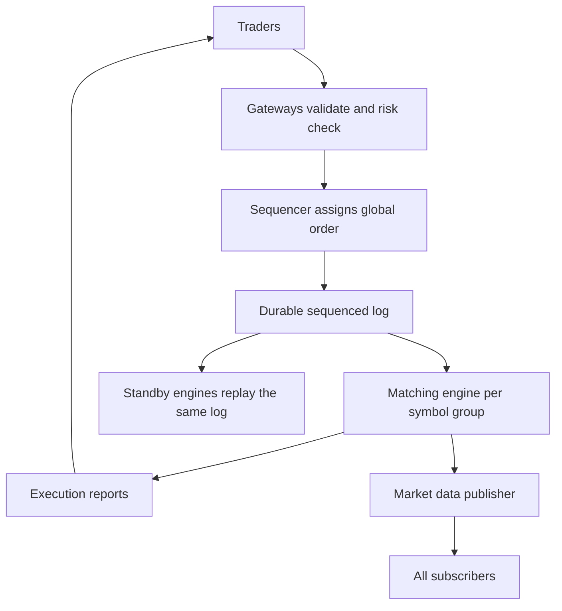

## The hook

Two traders, in two different cities, send an order to buy the last 100 shares at ₹101 at almost exactly the same instant. One of them gets the shares, the other does not. Millions of rupees can depend on who was "first".

An exchange's job sounds simple: match buyers and sellers. Its real job is to be *provably fair*, so everyone agrees on the order of events, and fast, so nobody gets an edge from the system itself.

Predict the design choice that surprises most engineers: is the core of a modern exchange a highly parallel distributed system, or a single thread? (A single thread, per stock, and for very good reasons.)

## Requirements

**Functional**
- Accept limit and market orders, cancellations and modifications.
- Match orders by price-time priority; report trades to both sides.
- Publish market data: trades and order book updates.

**Non-functional**
- Fairness: one official order of events, applied identically for everyone.
- Very low and predictable latency.
- No lost orders or trades; fast recovery; full audit trail.

:::analogy
An exchange is **an auctioneer matching bids and asks**. Buyers shout the highest price they will pay, sellers the lowest they will accept. The auctioneer keeps two ordered lists and, the moment a bid meets an ask, declares a trade, always serving the best price first and, at the same price, whoever spoke first. A clerk numbers every shout so there is never any argument about who spoke first.
:::

## Back-of-envelope numbers

All **estimates**, as orders of magnitude rather than any exchange's real figures.

- Thousands of symbols; the busiest receive many thousands of orders per second at peaks, quieter ones far fewer.
- Order books fit easily in memory: even a busy symbol has only thousands to hundreds of thousands of resting orders.
- Market data fan-out: every book change goes to every subscriber, so output volume is far larger than input.

## High-level design

## Deep dives

### 1. The order book and matching

The **[[order book]]** keeps bids sorted by highest price, asks by lowest price, and orders at the same price in arrival order. The **[[matching engine]]** applies **[[price-time priority]]**:

| Ask | Price | Quantity | Arrived |
|---|---|---|---|
| A1 | ₹100 | 200 | first |
| A2 | ₹101 | 150 | second |
| A3 | ₹101 | 100 | third |
| A4 | ₹102 | 300 | fourth |

A buy for 300 limited to ₹101 trades 200 with A1 at ₹100, then 100 with A2 at ₹101 (A2 arrived before A3). A2 keeps 50; A3 and A4 are untouched. If the buy had been larger than everything at or below ₹101, the remainder would rest in the book as a bid.

### 2. The sequencer: deciding who was first

The **[[sequencer]]** stamps every validated order with one global sequence number and writes it to a durable log before matching. "First" means "lower sequence number", defined in one place, not by clocks on many machines (see [Watches That Never Quite Agree](article:system-design-time-ordering)).

### 3. Single-threaded, in-memory, deterministic

Each matching engine processes its symbols' sequenced orders one at a time, entirely in memory. No locks, no thread contention, no reordering. Wait, isn't that a bottleneck? A single core doing simple in-memory work handles a very large number of orders per second, and different symbols are spread across many engines, so the system scales by symbol.

Because the engine is deterministic, **[[deterministic replay]]** of the sequenced log rebuilds its exact state. Hot standbys consume the same log and stay identical; on failure, a standby takes over with the same book.

### 4. Gateways and risk checks

Gateways authenticate participants, validate orders and run pre-trade risk checks (credit limits, price bands, order size caps) before orders reach the sequencer, so bad orders never enter the official sequence.

### 5. Market data

Every trade and book change becomes **[[market data]]**, published to all subscribers at the same time through multicast or fair, equally provisioned connections. Fairness extends here: no participant should systematically see updates earlier because of the exchange's own design.

:::insight
An exchange is fair because one sequencer fixes a single global order of events and a deterministic, single-threaded matching engine applies that order to an in-memory book. The same property makes recovery simple: replay the durable log and you get the same state.
:::

## Trade-offs

| Decision | Choice | Trade-off |
|---|---|---|
| Matching | Single-threaded per symbol group | Deterministic and lock-free; scale by symbol |
| Ordering | Central sequencer | Unambiguous fairness; must be extremely reliable and fast |
| Durability | Sequenced log before matching | Recoverable; adds a little latency |
| Failover | Hot standby replaying the log | Fast takeover; double infrastructure |
| Market data | Simultaneous broadcast | Fairness; specialised networking |

:::warning
Common misconception: "a busier exchange needs a more parallel matching engine." Parallel matching of one order book would require locks and would make the order of matches depend on thread timing, destroying fairness and reproducibility. Exchanges scale by giving different symbols to different single-threaded engines.
:::

:::try-this
After the trade in the table, a new sell order for 120 shares at ₹101 arrives, followed by a buy for 160 at ₹101. What trades happen? (The sell rests behind A2 (50 left) and A3 (100) at ₹101. The buy for 160 takes A2's 50, then 100 from A3, then 10 from the new sell, in time order at ₹101. The new sell keeps 110.)
:::

## What can go wrong

- **Non-determinism** (timers, thread scheduling, floating-point differences) making standbys diverge.
- **Sequencer failure** halting trading; it needs its own failover.
- **Unfair market data**, where some subscribers consistently receive updates earlier.
- **Runaway algorithms** flooding orders; price bands, rate limits and kill switches at the gateway.
- **Clock-based ordering** instead of sequence numbers.

### Interview follow-ups

**"How do you handle a cancel that races with a match?"** Both are sequenced; whichever has the lower sequence number is applied first. If the match came first, the cancel finds nothing left and is rejected.

**"How do you store order book data for later analysis?"** The sequenced input log plus the output event log are the complete history; analytics systems consume copies asynchronously, never on the matching path.

**"How would you reduce latency?"** Keep everything in memory, avoid locks and memory allocation on the hot path, co-locate components, use efficient binary protocols, and keep the path from gateway to engine short.

## Further reading

- Martin Thompson and colleagues on the LMAX architecture and the Disruptor (a single-threaded, in-memory business logic design for exchanges).
- Public documentation from exchanges describing order types and price-time priority.

## Key takeaways

- An order book keeps bids and asks sorted by price and time, and a matching engine applies price-time priority to produce trades.
- A sequencer assigns one global sequence number to every order, so "who was first" is decided in one place rather than by clocks.
- Matching engines are single-threaded, in-memory and deterministic, and the system scales by assigning different symbols to different engines.
- Durable sequenced logs plus deterministic replay make recovery and hot standbys straightforward.
- Fairness extends to market data, which must reach all participants without systematic advantage.
