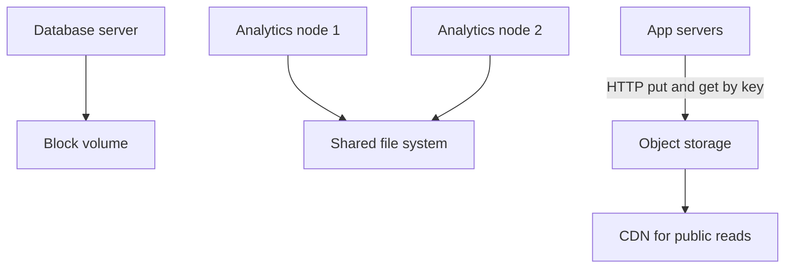

## The hook

Three teams ask the platform engineer for "some storage".

The database team wants their PostgreSQL files to live somewhere fast. The analytics team wants 50 machines to read the same folder of CSV exports. The product team wants to store every photo users have ever uploaded, forever.

Give all three the same thing, and at least two will be miserable: one with a slow database, one with a huge bill or a system that cannot hold billions of files. Before reading on, guess which kind of storage each team should get. The names are in the title. And hold on to the photo team: their choice hides a trap about folders that only shows up at a billion files, and we'll spring it later.

## The intuition

:::analogy
**A hard drive** inside your own laptop is fast and fully yours, but only your laptop can use it. **A shared folder** on the office network lets everyone open the same files by path. **A parcel locker** at the station holds sealed parcels by locker number: you drop off or pick up the whole parcel, you never edit what is inside it, and the station can have thousands of lockers.
:::

- The hard drive is **[[block storage]]**.
- The shared folder is **[[file storage]]**.
- The parcel locker is **[[object storage]]**, the kind described in [The Cloakroom That Never Loses a Coat](article:system-design-blob-storage).

So: the database team gets block storage, the analytics team a shared file system (or, more often today, object storage plus tools built for it), and the product team object storage.

## How it works

### Block storage

The machine sees a raw disk. It formats it with its own file system and reads or writes any block in place. Latency is low and small random writes are cheap, measured in **[[IOPS]]**. Usually one machine attaches a volume at a time.

### File storage

A network file system with directories, paths, permissions and file locks. Many machines mount it at once and see the same files. Convenient for shared content, home directories and legacy applications, but performance depends on the network and the file server.

### Object storage

A flat namespace of keys (`photos/2026/11/abc123.jpg`), each holding a whole object plus metadata, accessed through an HTTP API. Writes replace whole objects. It scales to enormous numbers of objects, spreads them across many machines, and achieves very high **[[durability]]** with replication or erasure coding, at a low price per gigabyte.

Wait, why can't object storage just edit the middle of a file like a disk? Because its design trades in-place edits for scale and durability: whole immutable objects are easy to copy, erasure-code, cache and serve from anywhere.

:::insight
Choose storage by access pattern: small in-place reads and writes from one machine want block storage; many machines sharing paths want a file system; huge numbers of whole files written once and read often want object storage.
:::

## Trade-offs

| | Block | File | Object |
|---|---|---|---|
| Access | Raw blocks, local file system on top | Paths over the network | Whole objects by key over HTTP |
| Sharing | Usually one machine | Many machines | Any number of clients |
| Edits in place | Yes, cheap | Yes | No, replace the whole object |
| Latency | Lowest | Low to moderate | Higher per request |
| Scale | Size of a volume | Size of the file system | Effectively huge numbers of objects |
| Cost per GB | Highest | Middle | Lowest |
| Typical use | Databases, boot disks, queues' logs | Shared content, legacy apps, home folders | Media, backups, logs, data lakes, static websites |

Here is the folder trap promised in the hook. Predict the cost: a nightly job lists a "folder" with 10 million objects to find yesterday's files. In object storage, there are no real folders, only key prefixes, and listing walks through keys page by page. Designs that use date-based prefixes (`logs/2026/11/03/`) keep such listings small.

:::warning
Common misconception: "object storage is just a slow, cheap disk, so mount it and use it like one." Object stores do not support in-place edits or cheap renames, and listing is paginated, so software expecting file-system behaviour can be slow or incorrect. Use object storage through its API, or through tools designed for it, such as data-lake query engines.
:::

:::try-this
A video platform stores raw uploads, transcoded segments and a metadata database. Pick storage for each. (Raw uploads and transcoded segments: object storage, served through a CDN. Metadata database: block storage attached to the database servers. Temporary scratch space for transcoding workers: local disk or a block volume per worker.)
:::

## What can go wrong

- **Database on network file storage** that does not honour its locking and durability assumptions: corruption or poor performance.
- **Running out of IOPS** on block volumes even with free space; size for IOPS, not only capacity.
- **Huge flat prefixes** in object storage making listings slow; design key prefixes.
- **Treating object storage as consistent for complex multi-object updates**: write a manifest last, or use a table format built for it.
- **Egress costs**: serving large objects directly to users can be expensive; put a CDN in front.

### Interview follow-ups

**"How would you design storage for user-uploaded profile pictures?"** Object storage with keys like `avatars/<user-id>/<hash>.jpg`, metadata (key, size, owner) in the database, uploads through pre-signed URLs, and a CDN for reads.

**"Why not store images in the database?"** Large binary columns bloat the database, its backups and replication, and waste its expensive memory and IOPS on bytes it never queries.

**"What does 'eleven nines of durability' mean?"** Providers state design targets for the chance of losing an object in a year; check your provider's documentation for the exact figure. The point for interviews: object stores achieve durability with many copies or erasure-coded pieces across failure domains.

## In the real world

- Cloud providers offer all three: block volumes for VMs, managed network file systems, and object stores such as Amazon S3, Google Cloud Storage and Azure Blob Storage.
- Data lakes store analytics data as files in object storage and query them with distributed engines, the topic of the warehouse and batch-processing articles.

## Further reading

- Your cloud provider's documentation comparing its block, file and object storage services.
- The storage chapters of Martin Kleppmann's *Designing Data-Intensive Applications*.

## Key takeaways

- Block storage is a raw disk for one machine, with low latency and cheap in-place writes, which suits databases and boot disks.
- File storage is a shared network file system that many machines access by path, which suits shared content and legacy applications.
- Object storage holds whole objects by key over HTTP, scales to billions of objects with high durability at low cost, and suits media, backups and data lakes.
- Choose by access pattern, and do not treat object storage as a normal disk: it has no in-place edits, no cheap renames and paginated listings.
