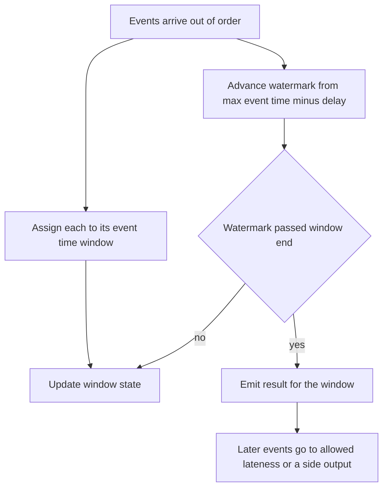

## The hook

A highway toll system counts cars per minute to detect traffic jams. Each gate sends an event when a car passes. Most events arrive within a second. But one gate's network link is flaky, and its events sometimes arrive minutes late, all at once.

The first version counts events per minute as they arrive. When the flaky gate reconnects, the dashboard shows a sudden "jam": 40 cars in one minute on an empty road. A minute earlier it showed almost nobody, when traffic was actually normal.

Nothing was lost. The events were just counted in the wrong minute. Predict how you would fix that, and then the harder question: how long do you wait for late events before publishing a minute's count? Wait forever and the dashboard is never done; wait too little and the counts are wrong.

## The intuition

:::analogy
You are **counting cars per minute when some gates report late**. The honest count for 9:00 to 9:01 must include every car that passed in that minute, whenever its report arrives. But you also have to publish numbers. So you decide: "I will publish the 9:00 minute once I am fairly sure the reports for it are in, say once I have seen reports from 9:01:20 onward. Anything later than that, I will log separately."
:::

That paragraph contains the core ideas:

- Count by **[[event time]]** (when the car passed), not **[[processing time]]** (when the report arrived).
- Group events into **[[window]]s** of event time (each minute).
- Decide when a window is complete with a **[[watermark]]**, and choose a policy for events that arrive after it.

## How it works

### Windows

- **Tumbling**: fixed, non-overlapping windows (every minute).
- **Sliding**: overlapping windows (the last 5 minutes, updated every minute).
- **Session**: windows that close after a gap of inactivity (one user's browsing session).

### Watermarks, traced

Eight events, as (event time, arrival time) in seconds. One-minute tumbling windows. The watermark is "largest event time seen so far minus 20 seconds", and a window closes when the watermark passes its end.

| Arrival | Event time | Window | Watermark after it | Result |
|---|---|---|---|---|
| 6 | 5 | [0, 60) | −15 | counted |
| 21 | 20 | [0, 60) | 0 | counted |
| 62 | 58 | [0, 60) | 38 | counted |
| 66 | 65 | [60, 120) | 45 | counted |
| 70 | 40 | [0, 60) | 45 | counted: late, but window still open |
| 76 | 75 | [60, 120) | 55 | counted |
| 112 | 110 | [60, 120) | 90 | counted; watermark passes 60, **[0, 60) closes with 4** |
| 125 | 30 | [0, 60) | 90 | **too late**: window already closed |

Compare three answers for the first two minutes:

| Method | Minute [0, 60) | Minute [60, 120) |
|---|---|---|
| True counts | 5 | 3 |
| Processing-time windows (by arrival) | 2 | 5 (plus 1 in the third minute) |
| Event-time windows with watermark | 4 | 3 |

Processing time is badly wrong. Event time with a watermark is nearly right, except for the event that arrived 95 seconds late.

### Handling the stragglers

Choices for events behind the watermark:

- **[[Allowed lateness]]**: keep the window's state a while longer and emit a corrected result.
- **Side output**: send late events to a separate stream for a later batch correction.
- **Drop**, and count how many were dropped.

Wait, why not just keep every window open forever? Because state grows without limit and results are never final. Every streaming system trades completeness against latency and memory.

### State and checkpoints

Counting per window means keeping state: partial counts, open windows, join tables. If a worker crashes, that state must not vanish. Stream processors write periodic **[[checkpoint]]s**: a consistent snapshot of all state plus the input positions (for example, Kafka offsets) at that moment. After a crash, they restore the snapshot and replay input from those positions. Combined with transactional or idempotent output, this gives effectively-once results.

:::insight
Streams are unbounded and out of order, so correctness needs three things: compute over event time, use watermarks to decide when a window's result is ready, and checkpoint state together with input positions so crashes neither lose nor double-count events.
:::

## Trade-offs

| Choice | Lower | Higher |
|---|---|---|
| Watermark delay | Faster results, more late events dropped | Slower results, more complete |
| Allowed lateness | Less state, fewer corrections | Corrections for stragglers, more state |
| Window size | Finer detail, more windows and state | Smoother, cheaper |
| Checkpoint interval | Less replay after crashes, more overhead | Less overhead, more replay |

Stream versus batch: streams give low latency on unbounded data but must handle disorder; batch, as in [Counting Votes in Every Booth, Then Adding the Totals](article:system-design-batch-processing), processes complete, bounded data simply, but only after it is all collected. Many systems use streams for fresh approximate numbers and batch jobs to publish the final, corrected ones.

:::warning
Common misconception: "events arrive in the order they happened." Mobile devices go offline, networks retry, partitions are read at different speeds, and clocks differ. Any design that assumes ordered arrival will put events in the wrong windows. Use event time, watermarks and a late-data policy.
:::

:::try-this
In the traced example, change the watermark delay from 20 to 100 seconds. What happens to the event with event time 30 that arrived at 125, and what is the cost? (When it arrives, the largest event time seen is 110, so the watermark is 10, and window [0, 60) is still open. The event is counted and the first minute gives the true 5. The cost: that window's result is published much later, and state for open windows is held longer.)
:::

## What can go wrong

- **Processing-time windows** for event-time questions: spikes and dips caused by delivery delays.
- **Watermarks stuck** because one partition or source is idle; mark idle sources so they do not hold everyone back.
- **Unbounded state** from keys that never expire (session windows that never close, joins without time limits).
- **Double counting after restarts** without checkpoints and idempotent or transactional sinks.
- **Skewed keys** making one worker hot, as in batch processing.

### Interview follow-ups

**"Design real-time ad click counts per campaign per minute."** Clicks go into a partitioned log keyed by campaign; a stream job aggregates per campaign per event-time minute with a watermark of, say, a few minutes; results go to a fast store for dashboards; a nightly batch job recomputes final billing numbers from the raw log.

**"How do you get exactly-once results?"** Exactly-once delivery is not available over a network, but effectively-once results are: checkpoint state with input offsets, and write outputs transactionally or idempotently, as discussed in the message queue articles.

**"Lambda or kappa architecture?"** Lambda runs a batch layer and a speed layer side by side and merges them; kappa uses one streaming pipeline and reprocesses by replaying the log. Kappa is simpler if the stream engine is reliable enough.

## In the real world

- Apache Flink, Kafka Streams and Spark Structured Streaming provide event-time windows, watermarks and checkpointed state.
- The Google Dataflow model, from the paper "The Dataflow Model" (VLDB 2015), shaped how windows, watermarks and triggers are described today.
- Logs such as Kafka, as in [The Ticket Rail Between Waiters and Cooks](article:system-design-message-queues), are the usual input and output of stream jobs.

## Further reading

- Akidau et al., "The Dataflow Model" (VLDB 2015).
- Tyler Akidau, Slava Chernyak and Reuven Lax, *Streaming Systems*.

## Key takeaways

- Stream processing computes over unbounded, out-of-order data, so results must be defined by event time rather than arrival time.
- Windows (tumbling, sliding, session) bound the computation, and watermarks estimate when a window's events have arrived so its result can be emitted.
- Late events need an explicit policy: allowed lateness with corrected results, a side output, or counted drops.
- Checkpoints save state together with input positions, so a crashed job resumes without losing or double-counting events.
- Watermark delay trades result latency against completeness, which is why many systems pair fast streaming results with later batch corrections.
