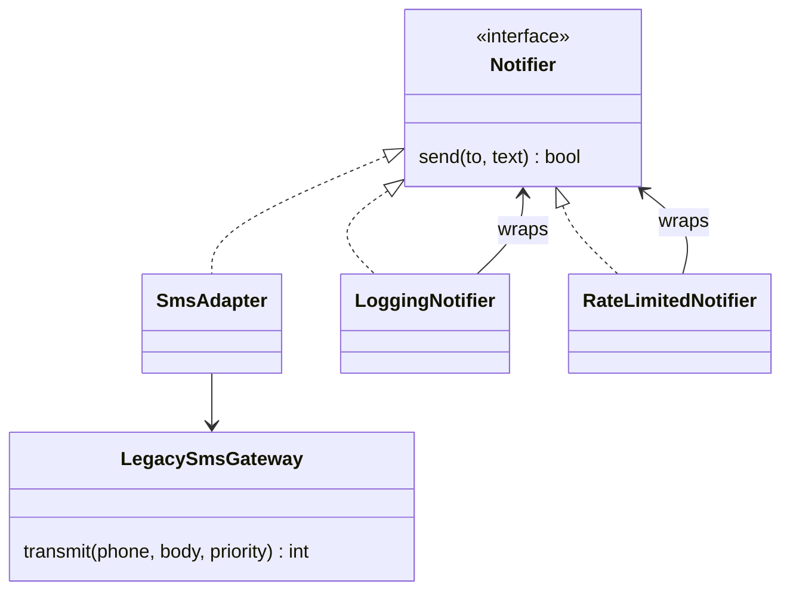

## The hook

Your food-delivery app's notification code is clean: every channel implements `Notifier.send(to, text)`. Then two requests arrive on the same day.

One: the business signs a cheaper SMS vendor whose SDK looks nothing like your interface. Two: some notifications need logging, some need rate limiting, some need retries, in any combination, for SMS, email and push.

The obvious answer to the second request is subclasses: `LoggedRateLimitedSmsNotifier`, `RetryingLoggedEmailNotifier`, and so on. Predict how many classes that needs for 3 channels and 3 optional features. The answer is 24, and it doubles with every new feature. The structural patterns are how you get it down to 6, and how you plug in the vendor without touching either side.

## Requirements

- Use a third-party SMS SDK whose methods and types differ from `Notifier`, without changing the SDK or the code that calls `Notifier`.
- Add logging, rate limiting and retries to any notifier, in any combination, chosen at runtime.
- Give other teams one simple call for "notify this customer about this order" that hides template lookup, preferences and channel choice.
- Load an expensive template catalogue only when first needed.

:::analogy
Travelling abroad, you carry **a plug adapter** so your charger fits the foreign socket: neither the charger nor the wall changes. You put **a phone case** on your phone: it is still the same phone with the same buttons, but now it also has a grip, a wallet and a stand, and you can add or remove cases freely.
:::

The plug adapter is the **[[adapter]]**. The phone case is the **[[decorator]]**. Two more members of the family appear below: the **[[facade]]** and the **[[proxy]]**.

## Core objects

- **Notifier** (interface): `send(to, text) → bool`.
- **LegacySmsGateway**: the vendor SDK we cannot change.
- **SmsAdapter**: makes the vendor look like a Notifier.
- **LoggingNotifier, RateLimitedNotifier, RetryingNotifier**: decorators.
- **CustomerNotificationFacade**: one call for other teams.
- **TemplateCatalogProxy**: loads templates lazily.

## Class design

### Adapter: make it fit

```pseudo
class SmsAdapter implements Notifier:
    constructor(vendor: LegacySmsGateway)
    send(to, text):
        code = vendor.transmit("+91" + to, text, priority = 1)
        return code == 202        // translate the vendor's result into ours
```

Neither the checkout code nor the vendor SDK changes. If the vendor is replaced next year, only the adapter changes.

### Decorator: add behaviour without subclasses

Each decorator implements `Notifier` and holds another `Notifier`:

```pseudo
class LoggingNotifier implements Notifier:
    constructor(inner: Notifier)
    send(to, text):
        log("sending to " + to)
        ok = inner.send(to, text)
        log("result " + ok)
        return ok
```

Compose at runtime: `RateLimited(Logging(SmsAdapter(vendor)))`. Wait, why does order matter? The outermost decorator runs first. Rate limiting outside logging means blocked messages are never logged as attempts; swap them and every blocked attempt is logged. Choose the order that matches what you want to observe.

The **[[subclass explosion]]** that decorators avoid:

| Approach | Classes for 3 channels × 3 optional features |
|---|---|
| A subclass per combination | 3 × 2³ = 24 |
| Decorators | 3 channels + 3 decorators = 6 |

### Facade: one call for everyone else

```pseudo
class CustomerNotificationFacade:
    notifyOrderUpdate(customerId, orderId, status):
        prefs = preferences.get(customerId)
        template = templates.get(status, prefs.language)
        text = template.render(orderId)
        for channel in prefs.channels: notifiers[channel].send(prefs.contact[channel], text)
```

Teams call one method instead of learning five classes.

### Proxy: control access to the real thing

```pseudo
class TemplateCatalogProxy implements TemplateCatalog:
    real = null
    get(status, language):
        if real is null: real = loadCatalogFromStorage()     // lazy, on first use
        return real.get(status, language)
```



## Key flows

The C++ program composes rate limiting (2 messages allowed), logging and the adapter around the vendor SDK, then sends three messages:

| Message | Rate limiter | Logging | Adapter and vendor | Returned |
|---|---|---|---|---|
| 1 | 1 left after | logs "sending", "ok" | sends +919876543210, code 202 | true |
| 2 | 0 left after | logs "sending", "ok" | sends, code 202 | true |
| 3 | blocked | not reached | not reached | false |

```cpp
#include <bits/stdc++.h>
using namespace std;

// The interface the checkout code already uses.
struct Notifier {
    virtual bool send(const string& to, const string& text) = 0;
    virtual ~Notifier() = default;
};

// A vendor SDK with a different shape that we cannot change.
struct LegacySmsGateway {
    int transmit(const string& phoneWithCountryCode, const string& body, int priority) {
        cout << "  [legacy gateway] " << phoneWithCountryCode << " p" << priority << ": " << body << "\n";
        return 202;                                          // vendor's "accepted" code
    }
};

// Adapter: makes the legacy gateway look like a Notifier.
struct SmsAdapter : Notifier {
    LegacySmsGateway& gw;
    explicit SmsAdapter(LegacySmsGateway& g) : gw(g) {}
    bool send(const string& to, const string& text) override {
        return gw.transmit("+91" + to, text, 1) == 202;       // translate arguments and result
    }
};

// Decorators: same interface, wrap another Notifier, add one behaviour each.
struct LoggingNotifier : Notifier {
    unique_ptr<Notifier> inner;
    explicit LoggingNotifier(unique_ptr<Notifier> n) : inner(move(n)) {}
    bool send(const string& to, const string& text) override {
        cout << "  [log] sending to " << to << "\n";
        bool ok = inner->send(to, text);
        cout << "  [log] result " << (ok ? "ok" : "failed") << "\n";
        return ok;
    }
};

struct RateLimitedNotifier : Notifier {
    unique_ptr<Notifier> inner;
    int remaining;
    RateLimitedNotifier(unique_ptr<Notifier> n, int limit) : inner(move(n)), remaining(limit) {}
    bool send(const string& to, const string& text) override {
        if (remaining == 0) { cout << "  [limit] blocked\n"; return false; }
        remaining--;
        return inner->send(to, text);
    }
};

int main() {
    LegacySmsGateway vendor;
    // Compose at runtime: rate limit -> logging -> adapter -> vendor SDK.
    unique_ptr<Notifier> n = make_unique<RateLimitedNotifier>(
        make_unique<LoggingNotifier>(make_unique<SmsAdapter>(vendor)), 2);
    for (int i = 1; i <= 3; i++) {
        cout << "message " << i << ":\n";
        bool ok = n->send("9876543210", "Order 50" + to_string(i) + " is on the way");
        cout << "  returned " << ok << "\n";
    }
}
```

:::insight
Structural patterns change how objects fit together rather than what they do: an adapter translates an interface, a decorator adds a responsibility while keeping the interface, a facade hides a subsystem behind one call, and a proxy controls access to the real object. Wrapping beats rewriting and beats exploding subclass hierarchies.
:::

:::try-this
Add retries (up to 2 extra attempts) to the chain. Where should RetryingNotifier go relative to RateLimitedNotifier, and why? (Inside the rate limiter, wrapping logging and the adapter: one user message consumes one rate-limit slot however many retries it needs. Put it outside, and each retry passes through the limiter and consumes a slot, so one flaky send could use up the whole budget.)
:::

## Patterns used

- **Adapter** for the vendor SDK: decouples our interface from a third party.
- **Decorator** for logging, rate limiting and retries: composable, runtime-selected behaviours, following the open/closed idea in [Lego Bricks With Standard Studs](article:system-design-oop-solid).
- **Facade** for other teams: one entry point, fewer dependencies.
- **Proxy** for the template catalogue: lazy loading; the same shape works for caching and permission checks.

Factories from [The Car Factory and the Custom Configurator](article:system-design-creational-patterns) usually build these chains, so callers never assemble decorators by hand.

## Extensions

- **"Add metrics to every notifier."** One more decorator; no other class changes.
- **"Switch SMS vendors per country."** One adapter per vendor and a factory that picks by country.
- **"Cache rendered templates."** A caching proxy in front of the template renderer.
- **"Audit who sent what."** An audit decorator at the outermost layer.

### Interview follow-ups

**"Decorator or inheritance?"** Inheritance fixes the combination at compile time and multiplies classes; decorators compose at runtime with one class per feature. Use inheritance for true is-a relationships, decorators for optional add-ons.

**"Adapter or facade?"** An adapter makes one interface look like another specific interface; a facade simplifies a whole subsystem behind a new, simpler interface.

**"Where do you see decorators in real libraries?"** Buffered and compressed streams wrapping file streams, and middleware chains in web frameworks that wrap request handlers with logging, auth and timing.

Next comes the logging framework in [Design a Logging Framework](article:system-design-logger-lld), where decorators and the chain of responsibility meet a real design problem.

## Key takeaways

- Structural patterns combine objects by wrapping them instead of rewriting them or multiplying subclasses.
- An adapter converts a third-party or legacy interface into the one your code expects, so neither side changes.
- Decorators keep the same interface and add one behaviour each, so features compose at runtime: 6 classes instead of 24 for three channels and three features.
- A facade hides a complicated subsystem behind one simple call, and a proxy controls access to the real object, for example with lazy loading or caching.
- Decorator and proxy look alike; explain the intent, adding behaviour versus controlling access.
