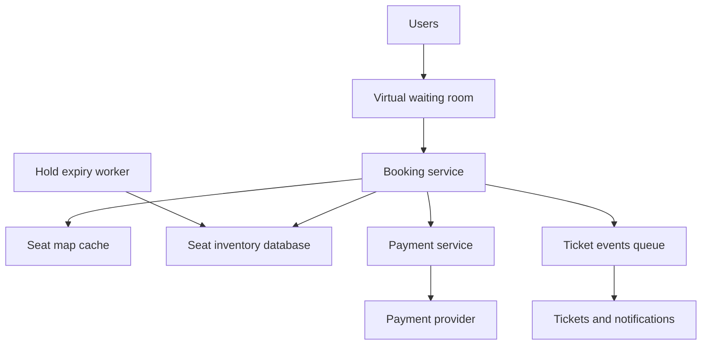

## The hook

10:00 am. A stadium concert with 50,000 seats goes on sale. Two million fans are already refreshing the page. At 10:00:01, thousands of them click on the same front-row seats.

Two things must never happen. A seat must never be sold twice. And the site must not fall over, because a crashed site during a sale is front-page news.

Most designs fail on the first one in a quiet way: the code checks "is the seat free?", then books it. Predict what goes wrong when two requests run that code in the same millisecond. (Both see "free". Both book. Two people arrive at seat A12.) This case study builds the design that makes that impossible and keeps the site standing.

## Requirements

**Functional**
- Browse events and see a seat map with availability.
- Select seats and **hold** them while paying.
- Pay and receive a confirmed ticket.
- Holds that are not paid in time are released.

**Non-functional**
- **No double booking, ever.** Correctness beats availability for the seat itself.
- Survives flash-sale spikes far above normal traffic.
- Fairness: early arrivals should get earlier access.
- Payment failures and timeouts must never leave seats stuck or money taken without a ticket.

:::analogy
At a crowded wedding hall, an usher **puts a "reserved" sign on a seat for ten minutes** while your family parks the car. Nobody else may sit there. If your family does not arrive in time, the usher removes the sign and the seat is free again. The sign is placed by one usher, on one seat, at one moment, so two families can never both hold it.
:::

## Back-of-envelope numbers

All numbers are **estimates** for sizing, not data from any real platform.

- 2,000,000 users for 50,000 seats: **40 people per seat**. Most will not get one, and the design must say "sold out" quickly and politely.
- If those 2 million arrive within 10 minutes: about **3,300 arrivals per second** at the front door.
- Admit **2,000 users per minute** (about 33 per second) from a waiting room into the booking flow.
- About 20,000 users active in the booking flow at once, each refreshing the seat map every 5 seconds: **4,000 seat-map reads per second**, served from a cache.
- Each active user attempting a hold every 10 seconds: **2,000 hold attempts per second** at the seat database at peak.
- At 2,000 admitted users per minute buying an average of 2.5 seats each, 50,000 seats last about **10 minutes**.

The seat database sees thousands of writes per second, not millions, because the waiting room shapes the load.

## High-level design



1. Users wait in a **[[virtual waiting room]]** and are admitted at a controlled rate, roughly in arrival order.
2. The booking service shows a seat map from a cache, refreshed from the database every second or two.
3. Selecting seats creates a **[[seat hold]]** in the database with an expiry, say 10 minutes.
4. The user pays through the payment service with an idempotency key, as in [Design a Payment System](article:system-design-payments).
5. On payment success, the hold is **confirmed** into a booking; tickets are issued asynchronously.
6. An expiry worker releases holds whose time ran out.

## Deep dives

### 1. Holding a seat without races

Each seat row has a status (AVAILABLE, HELD, BOOKED), a hold id and a hold expiry. A hold is one **[[conditional update]]**:

```pseudo
UPDATE seats
SET status = 'HELD', hold_id = :h, hold_expires = now() + 10 minutes
WHERE event_id = :e AND seat_id = :s
  AND (status = 'AVAILABLE' OR (status = 'HELD' AND hold_expires < now()))
```

If it updates 1 row, the seat is yours. If it updates 0, someone else got it. The database executes the check and the change atomically for that row, so of two simultaneous requests, exactly one succeeds. This is **[[optimistic concurrency]]**: no lock is taken in advance; the condition decides.

For several seats at once ("4 seats together"), run the updates in one transaction, in a fixed seat order to avoid deadlocks, and roll back if any seat fails.

| Time | Request from Asha | Request from Ravi | Row A12 |
|---|---|---|---|
| t0 | | | AVAILABLE |
| t1 | UPDATE ... WHERE status = AVAILABLE | UPDATE ... WHERE status = AVAILABLE | |
| t2 | 1 row updated: hold h1 | waits on the row | HELD by h1, expires t0 + 10 min |
| t3 | | condition false, 0 rows | still HELD by h1 |
| t4 | "Seat held for 10 minutes" | "Sorry, just taken" | |

Wait, why not use a distributed lock per seat instead? You could, but the database row is already the single source of truth, and a conditional update is a lock and a write in one atomic step. A separate lock service adds a second system that must agree with the database; [One Key to the Shared Room, With a Numbered Tag](article:system-design-distributed-locks-sd) shows how much care that needs.

### 2. Expiry: giving seats back

Holds expire in two ways at once:

- **Lazily**: the hold query above treats an expired hold as available, so a seat is reusable the moment its hold lapses, even if no worker has cleaned it yet.
- **Actively**: an expiry worker periodically sets expired holds back to AVAILABLE and refreshes the seat-map cache, so other users *see* the seat again.

### 3. Payment and confirmation

Confirmation is another conditional update:

```pseudo
UPDATE seats SET status = 'BOOKED', booking_id = :b
WHERE seat_id = :s AND hold_id = :h AND hold_expires >= now()
```

Predict the edge case before reading on: the payment provider confirms success 30 seconds after the hold expired, and the seat already went to someone else.

The confirm update matches 0 rows. The booking service marks the payment for automatic refund and tells the user honestly. To make this rare, the hold timer shown to users is slightly shorter than the real expiry, and payment pages time out before the hold does.

Payments use idempotency keys, so a retried "pay" never charges twice. A payment stuck in "pending" keeps its hold alive only until a hard limit, after which it is reconciled with the provider.

### 4. Surviving the flash sale

- **Waiting room**: users get a position and are admitted at the rate the core can handle. This also gives fairness and stops bots from hammering the booking API directly.
- **Cache the seat map**, never compute it from the database per request. A seat map a second or two old is fine, because the hold itself is checked atomically.
- **Rate limit per user and per IP**, and require a waiting-room admission token on booking APIs, as in [Design a Rate Limiter](article:system-design-rate-limiter).
- **Partition by event**: one hot event's rows can live on their own database partition, so a sale does not slow every other event.

:::insight
Double booking is prevented in exactly one place: an atomic conditional update on the seat row, for holding and again for confirming. Everything else (the cache, the waiting room, the expiry worker) exists to keep that one place from being overwhelmed and to keep what users see close to the truth.
:::

## Trade-offs

| Decision | Choice | Gain | Give up |
|---|---|---|---|
| Concurrency control | Conditional updates on seat rows | Simple, atomic, no extra lock service | Hot rows on popular seats see contention |
| Hold duration | About 10 minutes | Time to pay | Seats look unavailable while held |
| Seat map | Cached, slightly stale | Cheap reads at scale | Users sometimes click a seat that was just taken |
| Waiting room | Admit at a controlled rate | Protects the core, fairness | Users wait; extra component |
| Consistency | Strong for seat state | No double booking | Seat database must be strongly consistent, not eventually consistent |

General-admission tickets (no seat numbers) change the shape: instead of many seat rows, keep a counter of remaining tickets and decrement it with a conditional update (`WHERE remaining >= :qty`), or split the counter into several sub-counters to spread contention.

:::warning
Common misconception: "check availability, then book, and it will be fine because it is fast." Check-then-act in application code always races, no matter how fast it is: two requests can both read "available" before either writes. The check and the change must be one atomic operation in the database (or protected by a properly fenced lock).
:::

:::try-this
A user selects 4 seats together. Seats 1 to 3 hold successfully, seat 4 fails because someone just took it. What should the system do, and why lock seats in a fixed order? (Roll back the transaction so seats 1 to 3 are released, and offer another block of 4. Updating seats in a fixed order, such as by seat id, prevents two users who want overlapping blocks from each holding some seats and waiting on the other's, which would deadlock.)
:::

## What can go wrong

- **Double booking** from check-then-act code or from an eventually consistent seat store.
- **Seats stuck in HELD** if the expiry worker dies; the lazy expiry condition keeps them bookable, and monitoring on the worker catches it.
- **Money taken, no ticket**: payment succeeds after the hold expired; automatic refunds and reconciliation fix it.
- **Thundering herd at 10:00**: without a waiting room, the seat database receives the whole crowd.
- **Bots** buying everything: admission tokens, per-user limits and purchase caps.
- **Hot partition** for a mega-event: isolate it, and keep other events on other partitions.

### Interview follow-ups

**"Why not hold seats in Redis instead of the database?"** You can, with an atomic set-if-absent plus expiry, which is fast. But the booked state must still end up in a durable, strongly consistent store, and two systems must agree. Many designs hold in the database directly for simplicity, and cache the seat map in Redis.

**"How long should the hold be?"** Long enough for a normal payment (including bank OTP steps), short enough that abandoned holds return quickly. Show users a slightly shorter timer than the server uses.

**"How do you show 'sold out' fast to 1.9 million people?"** Keep a per-event remaining count in a cache and publish "sold out" to the waiting room, which can stop admitting and tell everyone in the queue.

**"How is this different from the low-level design question?"** The HLD is about scale, consistency and failure; the LLD in [Design a Movie Ticket Booking System](article:system-design-bookmyshow-lld) is about classes, states and patterns. Interviews may ask either; the seat-state machine is shared.

## Further reading

- The isolation and concurrency sections of [Several Cashiers, One Ledger](article:system-design-isolation-levels) for why conditional updates and row locks behave as they do.
- The "Transactions" chapter of Martin Kleppmann's *Designing Data-Intensive Applications*.

## Key takeaways

- Prevent double booking with a single atomic conditional update on the seat row, both when holding and when confirming, never with check-then-act in application code.
- Seat holds carry an expiry; expired holds count as available immediately and a background worker releases them for display.
- Confirmation must check that the hold is still yours, and late payments for lost holds are refunded automatically.
- A virtual waiting room, a cached seat map, rate limits and event-level partitioning keep a flash sale from overwhelming the seat database.
- Seat state needs strong consistency; everything users merely look at, such as the seat map, can be slightly stale.
