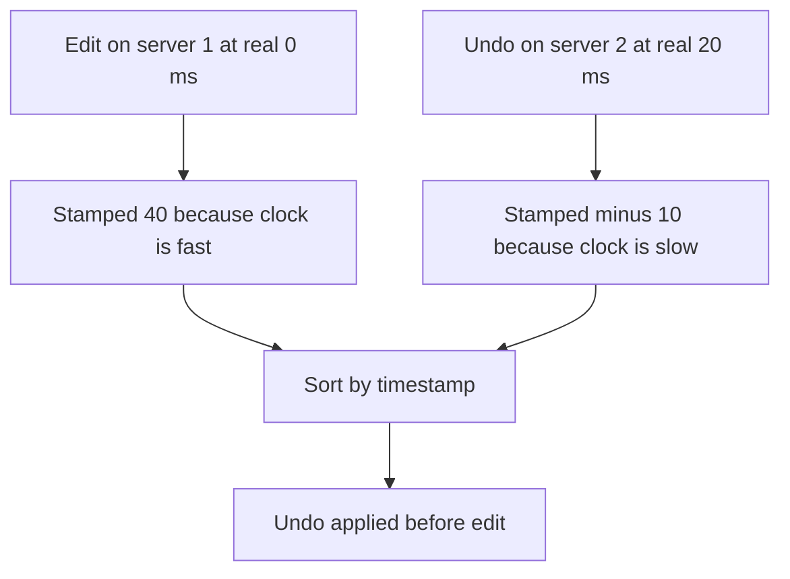

## The hook

A user edits a document on their laptop, which talks to server 1. Twenty milliseconds later they press "undo", which reaches server 2. The system orders changes by timestamp and applies them in that order.

The undo is applied first, then the edit. The document ends up in a state the user never saw, and their undo seems to have done nothing. Both servers had working clocks, synchronised minutes earlier.

Before reading on, think about how big the clock difference must have been for this to happen. (Bigger than 20 milliseconds, which is much less than you might think for ordinary servers.)

## The intuition

:::analogy
A group of friends each wear **watches that never quite agree**. Some run a little fast, some a little slow, and they reset them against a phone now and then. If two friends each write down the time of something they saw, you cannot reliably tell which happened first when the events were seconds apart. But if one friend says "I did this *after* she called me", you know the order for sure, without any watch at all.
:::

Physical clocks are the watches: useful, but never exact. Cause and effect ("after she called me") is what logical clocks capture.

## How it works

### Why wall clocks disagree

Every machine's quartz oscillator runs slightly fast or slow (**[[clock drift]]**), so clocks drift apart between corrections. **[[NTP]]** periodically corrects them by asking time servers, but network delays make the correction imperfect. The remaining difference between two machines is **[[clock skew]]**, often milliseconds and sometimes far more after a misconfiguration or a long pause.

Worse, corrections can make a wall clock **jump**, even backwards. Code that subtracts two wall-clock readings to measure a duration can get a negative number. That is why systems measure durations with a **[[monotonic clock]]**, which only moves forward.

### The hook, traced

| Event | Real time | Server clock error | Timestamp recorded |
|---|---|---|---|
| A: edit, on server 1 | 0 ms | +40 ms | 40 |
| B: undo, on server 2 | 20 ms | −30 ms | −10 |

Ordered by timestamp, B (−10) comes before A (40), reversing reality. A skew of 70 ms between the two servers beat a real gap of 20 ms.

### Three ways to order events

1. **Logical clocks.** A **[[logical clock]]** orders events by cause and effect: if A caused B (the undo was sent after the client saw the edit's response), A's timestamp is smaller. Lamport clocks give one consistent order; vector clocks also detect concurrent events, as in [Ordering Events Without Trusting Any Clock](article:famous-algos-lamport-clocks) and [Catching Two Edits That Never Saw Each Other](article:famous-algos-vector-clocks).

2. **A single sequencer.** Route the writes that must be ordered (one document's changes) through one leader that assigns sequence numbers. The order is whatever the leader saw, no clocks needed. This is what single-leader replication and per-partition logs do.

3. **Bounded uncertainty.** If a system knows its clock error is within ε, it can represent time as an **[[uncertainty interval]]** [now − ε, now + ε]. Two events whose intervals do not overlap are definitely ordered. Google's Spanner uses this idea (TrueTime) and waits out the uncertainty before committing, so timestamps match real order; that article comes next.

Hybrid logical clocks combine a physical timestamp with a logical counter, giving timestamps close to real time that still respect cause and effect.

Wait, then why does anyone use wall-clock timestamps at all? Because they are fine for things where small errors do not matter: log lines, "posted 5 minutes ago", expiring a cache entry. They are dangerous only when used to decide the order of conflicting writes.

:::insight
Physical clocks are approximations that drift and jump, so they cannot reliably order events that happen close together on different machines. Order by cause and effect with logical clocks, by a single sequencer, or by waiting out a known clock uncertainty, and keep wall clocks for display and coarse timing.
:::

## Trade-offs

| Approach | Gives | Costs |
|---|---|---|
| Wall-clock timestamps | Real time, simple | Wrong order under skew; jumps |
| Lamport clocks | Causal order, a total order with tie-breaks | No link to real time; cannot detect concurrency |
| Vector clocks | Detect concurrent writes | Size grows with participants |
| Single sequencer per key | Simple, exact order | That leader is a bottleneck and must fail over |
| Bounded uncertainty (TrueTime style) | Real-time order across the globe | Special clock hardware and waiting on commits |

:::warning
Common misconception: "our servers run NTP, so timestamps are accurate enough to order events." NTP keeps skew small, not zero, and clocks can jump or be misconfigured. Last-write-wins by timestamp, as in [Two Branch Managers Editing One Price List](article:system-design-multi-leader-leaderless), can silently drop the truly later write. Never use wall clocks alone to order conflicting updates.
:::

:::try-this
A distributed lock service hands out leases that expire after 10 seconds, and clients check expiry with their own wall clock. One client's clock jumps back 5 seconds after an NTP correction. What can go wrong, and what is safer? (The client may believe its lease is still valid for 5 extra seconds while another client already holds the lock. Measure lease durations with a monotonic clock on the client, keep a safety margin, and use fencing tokens so the resource rejects stale holders, as in [One Key to the Shared Room, With a Numbered Tag](article:system-design-distributed-locks-sd).)
:::

## What can go wrong

- **Last-write-wins with skewed clocks** dropping newer writes.
- **Durations from wall clocks** going negative or huge after corrections.
- **Leases and timeouts** misbehaving when clocks jump.
- **Log timelines** across services appearing out of order, misleading debugging; use trace ids, not only timestamps.
- **Leap seconds and time-zone bugs** in code that assumes a simple, smooth clock.

### Interview follow-ups

**"How would you order messages in a group chat across servers?"** Assign per-conversation sequence numbers from one place (the partition owner of that conversation), not client or server wall clocks.

**"How do you generate unique, roughly time-ordered ids?"** Combine a timestamp with a machine id and a per-machine counter (Snowflake-style); handle clocks moving backwards by waiting or refusing, as in [Design a Unique ID Generator](article:system-design-unique-id-generator).

**"Why do distributed databases care so much about clocks?"** Snapshot reads and transaction ordering need consistent timestamps; systems either use logical or hybrid clocks, a central timestamp service, or bounded-uncertainty clocks.

## In the real world

- NTP and the Precision Time Protocol synchronise clocks in data centres; cloud providers offer time services with improved accuracy.
- Spanner's TrueTime uses GPS and atomic clocks to bound uncertainty; CockroachDB uses hybrid logical clocks with a maximum allowed offset.
- Most databases assign transaction order through a leader or a log rather than by trusting clients' clocks.

## Further reading

- Leslie Lamport, "Time, Clocks, and the Ordering of Events in a Distributed System" (Communications of the ACM, 1978).
- The "Unreliable Clocks" section of Martin Kleppmann's *Designing Data-Intensive Applications*.

## Key takeaways

- Every machine's clock drifts and is corrected imperfectly, so clocks on different machines disagree by some skew and can even jump backwards.
- Wall-clock timestamps cannot reliably order events that are close together on different machines; skew can reverse the true order.
- Use monotonic clocks to measure durations, and logical clocks, a single sequencer per key, or bounded-uncertainty clocks to order events.
- Wall clocks remain fine for display, logs and coarse expiry, but never as the sole judge of which conflicting write wins.
