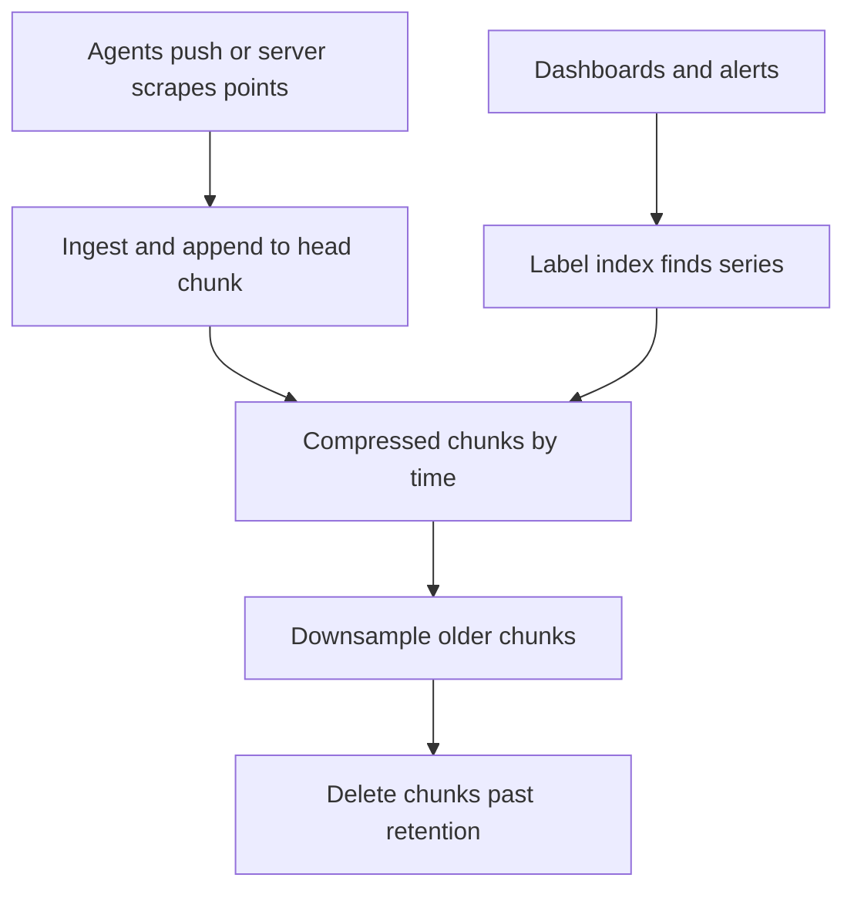

## The hook

Your monitoring system records request latency for every API endpoint on every host every 10 seconds. It works beautifully for months. Then a developer adds one more label to the metric, "user_id", to debug a slow customer.

By evening, the monitoring database is out of memory and the dashboards are blank. Ironically, you now cannot see why production is slow.

The data volume did not grow much. Something else exploded. Predict what before reading on. It is the most common way time-series databases fall over, and it has a name you will hear in every observability interview: cardinality.

## The intuition

:::analogy
A ship's log is **a diary where only new entries are written**. You never go back and edit Tuesday's line; you append today's. Entries come at regular times, look very similar to the previous ones, and old pages are eventually summarised ("calm week, average speed 12 knots") and the details thrown away.
:::

That is metrics data, and why it gets its own kind of database:

- **Append-only writes**: points arrive in time order and are almost never updated.
- **Regular and similar**: timestamps come at fixed intervals; consecutive values change little.
- **Old data matters less**: last hour at 10-second detail, last year at hourly averages.

## How it works

### The data model

A **[[time series]]** is identified by a metric name plus **[[label]]s**, and holds (timestamp, value) points:

`http_request_duration{endpoint="/checkout", method="POST", host="web-7", status="200"}`

Every distinct label combination is its own series. The database keeps an index from labels to series, and stores each series' points in compressed chunks by time.

### Compression

Predict the timestamps' cost. Points come every 10 seconds: 1000, 1010, 1020, 1030, 1041, 1051.

- Deltas between timestamps: 10, 10, 10, 11, 10.
- Deltas of those deltas: 0, 0, 1, −1.

Storing mostly zeros takes a bit or two each with **[[delta-of-delta encoding]]**. Values get similar treatment, for example XOR-ing each floating-point value with the previous one, which leaves mostly zero bits when values change slowly. Together, these schemes shrink points from 16 bytes (an 8-byte timestamp and an 8-byte float) to a small fraction of that; the exact ratio depends on the data.

### Downsampling and retention

| Resolution | Kept for | Points per series |
|---|---|---|
| Raw, every 10 s | 7 days | 7 × 24 × 3600 ÷ 10 = 60,480 |
| 1-minute rollups | 90 days | 90 × 24 × 60 = 129,600 |
| 1-hour rollups | 2 years | 2 × 365 × 24 = 17,520 |

**[[Downsampling]]** keeps min, max, average and count per bucket (not just the average, or spikes disappear). **[[Retention]]** deletes whole old chunks cheaply, because data is laid out by time.

### Cardinality

**[[Cardinality]]** is the number of distinct series, and it multiplies across labels. For labels endpoint (50 values), method (5), host (100) and status (10): 50 × 5 × 100 × 10 = **250,000** series. Each series costs memory for its index entry and its open chunk.

Add user_id with a million values and the possible series become 2.5 × 10¹¹. That is the hook's outage: not more data per series, but vastly more series, each with its own overhead.

Wait, why can't the database just handle more series like it handles more points? Because points are compressed together within a series, while every series needs its own index entry, memory buffers and metadata. Points are cheap; series are expensive.

:::insight
Time-series databases are fast and compact because points arrive in order, change slowly and age gracefully, so they append, compress deltas, and downsample old data. Their limit is not the number of points but the number of series, so keep labels bounded.
:::

## Trade-offs

| Decision | Choice | Gain | Cost |
|---|---|---|---|
| Collection | Pull (scraping) or push | Pull: server controls load, easy to see dead targets; push: works for short-lived jobs | Pull needs reachable targets; push needs back-pressure handling |
| Resolution | 10 s vs 60 s | Finer detail | 6 times more points |
| Retention | Long raw retention | Detailed history | Storage grows linearly |
| Labels | Rich labels | Flexible queries | Cardinality risk |

For per-request detail (which user, which request id), use logs or traces, which are built for high-cardinality data, and keep metrics aggregated.

:::warning
Common misconception: "labels are free, so add every useful dimension." Each label value combination creates a new series, and series are what time-series databases pay for in memory and indexing. Never use unbounded values such as user ids, request ids or full URLs with query strings as metric labels.
:::

:::try-this
A team wants latency per country (about 200 values) on a metric that already has 250,000 series. What is the worst-case series count, and what would you suggest? (Up to 250,000 × 200 = 50 million series, if every combination occurs. Suggest a separate, smaller metric with only endpoint and country labels, or per-region rather than per-country labels.)
:::

## What can go wrong

- **Cardinality explosions** from unbounded labels, the classic outage.
- **Averaging away spikes** when downsampling stores only averages; keep max and percentile sketches.
- **Out-of-order or very late points** rejected by engines optimised for in-order appends.
- **Querying long ranges at raw resolution**, scanning millions of points; route to rollups.
- **Monitoring the monitoring**: if the metrics database shares infrastructure with production and fails with it, you are blind during incidents.

### Interview follow-ups

**"Design a metrics system for 10,000 hosts."** Agents or a scraper collect metrics every 10 to 60 seconds; ingest nodes append into a time-series store sharded by series; downsampling jobs create rollups; an alerting engine evaluates rules on recent data; dashboards query rollups for long ranges.

**"How do you store percentiles across hosts?"** You cannot average percentiles. Store histograms or quantile sketches per host, which can be merged, then compute percentiles from the merged result.

**"Why not use a relational database?"** You can at small scale, but row-per-point storage, B-tree indexes on timestamps and lack of time-based compression and retention make it costly at metrics volumes.

## In the real world

- Prometheus, InfluxDB, TimescaleDB and similar systems target metrics workloads, with compressed chunks, retention policies and label indexes.
- Facebook's Gorilla paper (VLDB 2015) described delta-of-delta timestamps and XOR value compression for an in-memory time-series store, and those ideas are widely reused.
- The columnar ideas in [Reading One Column Instead of Every Row](article:system-design-olap-warehouses) apply here too: a series is essentially one sorted column of values.

## Further reading

- Pelkonen et al., "Gorilla: A Fast, Scalable, In-Memory Time Series Database" (VLDB 2015).
- The Prometheus documentation on data model, storage and the dangers of high-cardinality labels.

## Key takeaways

- Time-series data is append-only, regular and slowly changing, so time-series databases append to compressed chunks ordered by time.
- Delta-of-delta encoding turns regular timestamps into mostly zeros, and XOR-style value encoding does the same for slowly changing values.
- Downsampling into rollups with min, max, average and count, plus time-based retention, keeps long histories affordable.
- Every distinct label combination is a separate series, and cardinality, the product of label value counts, is the main scaling limit.
- Keep metric labels bounded and send per-request details to logs or traces instead.
