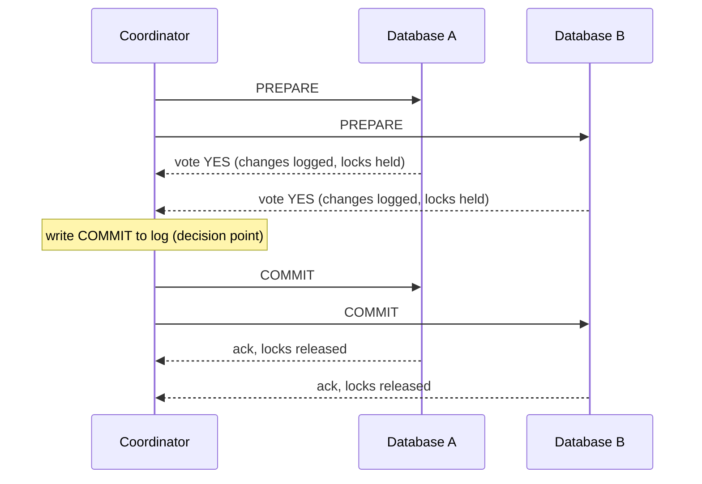

## The hook

A bank moves ₹5,000 from an account stored in database A to an account stored in database B. Database A subtracts the money and commits. A moment later, database B's disk fills up and its update fails. The money has left one account and arrived nowhere. Within one database, a transaction would have rolled both changes back together; across two databases, there is no single transaction to roll back.

Two-phase commit (2PC) is the classic protocol for making several databases act as one: either all of them commit, or none do. It is used inside distributed databases and by transaction managers, and it is asked in interviews mainly so you can explain *why* most microservice systems avoid it.

## The intuition

:::analogy
Think of a wedding. The officiant does not declare anyone married until both people have said "I do". First, the officiant asks each person in turn; each answer is a binding promise, and once you have said "I do" you cannot walk away. Only after hearing every "I do" does the officiant announce "you are married", and only then is it true for everyone. If either says "no", nobody is married. And if the officiant faints after both said "I do" but before the announcement, the couple are stuck at the altar, promised but not yet married, until someone who knows the outcome speaks.
:::

The officiant is the [[coordinator]], the couple are the [[participant]]s, "I do" is the prepare vote, and the announcement is the commit. The fainting officiant is the famous weakness of 2PC.

## How it works

### Phase 1: prepare

1. The coordinator sends PREPARE to every participant.
2. Each participant does all the work of the transaction: checks constraints, takes locks, writes the changes to its log so they survive a crash. Then it votes:
   - **Yes** means "I have made everything durable and I promise I can commit if you tell me to." From this point it may not abort on its own.
   - **No** means "I cannot commit." It can abort immediately.

### Phase 2: commit or abort

3. If every vote is yes, the coordinator writes COMMIT to its own durable log. That log write is the moment the transaction is decided. If any vote is no, or a participant does not answer in time, it decides ABORT.
4. The coordinator sends the decision to every participant. Each applies it, releases its locks, and acknowledges.
5. When all acknowledgements arrive, the coordinator can forget the transaction.

This achieves [[atomic commitment]]: all commit or all abort. Each participant's durable logging relies on a write-ahead log, as described in [Write It in the Ledger Before You Hand Over the Cash](article:famous-algos-write-ahead-log).

### The blocking problem

The dangerous window is after a participant votes yes and before it hears the decision. It is now an [[in-doubt transaction]]:

- It cannot commit on its own: maybe another participant voted no and the decision was abort.
- It cannot abort on its own: maybe the coordinator decided commit and others already committed.
- So it waits, **holding its locks**, until the coordinator recovers or another participant that knows the decision tells it.

A failure timeline for the coordinator crashing between the phases:

| Time | Coordinator | Database A | Database B |
|---|---|---|---|
| t1 | sends PREPARE | | |
| t2 | | votes YES, holds row locks | votes YES, holds row locks |
| t3 | writes COMMIT to log, **crashes** before sending | | |
| t4 | down | in doubt, locks held | in doubt, locks held |
| t5 | down | other transactions on those rows block | other transactions block |
| t6 | restarts, reads COMMIT from log | | |
| t7 | resends COMMIT | commits, releases locks | commits, releases locks |

Between t3 and t7, both databases are stuck, and every other transaction touching those rows waits. If the coordinator's disk is lost, a human may have to resolve in-doubt transactions manually. This is why 2PC is called a **blocking** protocol.

:::insight
2PC trades availability for atomicity. The yes vote is a promise that removes a participant's freedom to decide, so correctness depends on the coordinator coming back. Any protocol that guarantees all-or-nothing commits across machines has to pay for it somewhere: in waiting, in extra rounds, or in replicating the coordinator.
:::

### Reducing the blocking

- **Replicate the coordinator's decision** with a consensus protocol such as Raft, covered in [How Five Servers Agree on One Truth](article:famous-algos-raft), so a new coordinator can take over and read the decision. Distributed SQL databases commonly combine 2PC across shards with consensus-replicated participants and coordinators.
- **Participants can ask each other**: if any participant already knows the decision, or voted no, the others can learn the outcome from it.
- **Three-phase commit** adds a pre-commit round to avoid blocking under some failures, but it assumes bounded network delays and is rarely used in practice.

### When to use it

- **Inside one system you control**: across shards or partitions of a distributed database, with a replicated coordinator.
- **Across databases that support the XA standard**, in a single organisation, with low latency between them and short transactions.
- **Not across independently owned microservices or third-party APIs**: they will not hold locks waiting for your coordinator, and a slow or failed service would freeze everyone else. Use sagas instead, covered in [Book the Trip, Cancel the Hotel](article:system-design-sagas).

## Trade-offs

| Aspect | Two-phase commit | Alternative: sagas |
|---|---|---|
| Atomicity | true all-or-nothing | eventual, via compensations |
| Isolation | locks held across phases, no intermediate state visible | intermediate states visible |
| Latency | at least two network round trips plus forced log writes | each step commits locally |
| Availability | blocks if the coordinator fails at the wrong moment | each service continues independently |
| Coupling | all participants must speak the protocol and wait | services only exchange messages |

## What can go wrong

- **Coordinator crash after prepare**: participants stay in doubt and hold locks, as in the timeline above.
- **A slow participant** holds up everyone, because the coordinator waits for every vote. Use timeouts that lead to abort during phase 1.
- **Network partition during phase 2**: some participants receive COMMIT and others do not yet; the unreachable ones remain in doubt until the partition heals. The final outcome is still consistent, but delayed.
- **Lost coordinator log**: without the durable decision, in-doubt transactions need manual resolution.
- **Throughput collapse under contention**: locks held for two round trips make hot rows a bottleneck.

:::warning
Common misconception: "2PC is the right way to keep microservices consistent." It works within a database system or a tightly controlled set of resources. Across services owned by different teams, it couples their availability together and holds locks across network calls, so a single slow service can stall the whole system.
:::

:::try-this
Database B votes NO because a constraint fails. Database A had already voted YES. Walk through what happens. (The coordinator decides ABORT, logs it, and sends ABORT to both. B has already aborted; A, which was in doubt with locks held, rolls back its prepared changes and releases its locks. Nobody commits.)
:::

### Interview follow-ups

**"Why is 2PC called blocking?"** A participant that voted yes must wait for the coordinator's decision while holding locks. If the coordinator crashes at that moment, the participant can neither commit nor abort on its own.

**"How do real systems reduce that risk?"** Make the coordinator's decision durable and replicated (for example on a consensus group), so another node can finish the protocol, and keep transactions short.

**"Where is 2PC actually used?"** Inside one database system across its own shards, and in XA transactions between a database and a message broker. Across independently owned microservices, sagas with the outbox pattern are more common.

## In the real world

- Relational databases expose 2PC through the XA standard and commands such as PostgreSQL's `PREPARE TRANSACTION` and `COMMIT PREPARED`.
- Distributed SQL databases run 2PC-style commits across shards, with participants and coordinators replicated by consensus to avoid blocking on a single failure.
- Kafka's transactions use a transaction coordinator and a two-phase marker protocol to make writes to several partitions atomic.

## Further reading

- PostgreSQL documentation, PREPARE TRANSACTION: https://www.postgresql.org/docs/current/sql-prepare-transaction.html
- Gray and Lamport, "Consensus on Transaction Commit" (2006).
- Martin Kleppmann, *Designing Data-Intensive Applications*, chapter 9.

## Key takeaways

- Two-phase commit makes several participants commit or abort together by first collecting prepare votes, then broadcasting one decision.
- A yes vote is a binding promise: the participant has made its changes durable and can no longer abort on its own.
- The coordinator must log its decision durably before sending it, so it can finish the transaction after a crash.
- If the coordinator fails after participants vote yes, they are left in doubt, holding locks and blocking other work until the decision is recovered.
- 2PC suits shards inside one database system with a replicated coordinator, while independent microservices usually use sagas instead.
