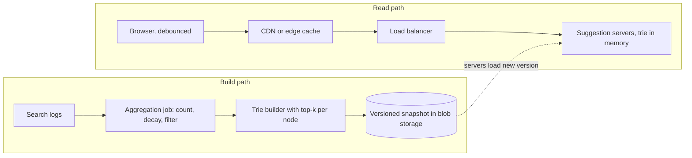

## The hook

You type "how to m" and, before your finger reaches the next key, a list appears: "how to make pancakes", "how to meditate", "how to make money online". The suggestions changed with each letter, they reflect what millions of other people are searching for, and they arrived faster than you can type.

Autocomplete looks like a small feature, but it is a demanding system: every keystroke is a request, the answer must arrive within the gap between keystrokes, and rankings must follow what people are searching for this week. It is a favourite interview question because it connects a data structure from DSA, the [[trie]], with caching, batch processing and latency budgets.

:::analogy
Think of a shopkeeper in a busy market who finishes your sentence. You say "I'd like some ma..." and they say "mangoes?" before you finish. They are not searching their whole stock as you speak. Every evening they look back over the day's orders and rehearse the most popular endings for every way a sentence might start. By morning, each beginning already has its answer ready.
:::

Rehearsing in the evening is offline aggregation; the ready answers are top-k lists stored at trie nodes; and the instant reply is a memory lookup.

## Requirements

**Functional**

1. Given a prefix, return the top 5 to 10 completions ranked by popularity.
2. Suggestions reflect recent search behaviour, updated at least daily, with trending queries faster if possible.
3. Filter offensive or unsafe suggestions.

**Non-functional**

- Very low latency: the full round trip should fit inside typing pauses, so aim for well under 100 ms end to end and a few milliseconds on the server.
- High availability: if autocomplete is down, search still works, so it can degrade gracefully, but it should rarely fail.
- High read volume, tolerant of slightly stale results.

Out of scope: spelling correction and full personalisation, though we will note where they plug in.

## Back-of-envelope numbers

All numbers are **estimates**.

- **Traffic:** 100 million daily users × 10 searches each × about 4 autocomplete requests per search (after debouncing) = 4 × 10⁹ requests per day ≈ **46,000 requests per second** on average, about **90,000** at a 2× peak.
- **Logs to aggregate:** 10⁹ searches per day × about 50 bytes per log entry ≈ **50 GB of logs per day**.
- **Suggestion data:** keep the top 10 million distinct queries, about 25 characters each, roughly 250 MB of raw text. Their prefixes number at most 250 million, far fewer after sharing; assume about 50 million trie nodes. A top-10 list of 8-byte query ids per node is 80 bytes, so about **4 GB** of top-k lists, plus the nodes themselves. That fits in memory on one large server, so we replicate the whole thing rather than shard it at first.

The workload is read-heavy, latency-critical and fits in RAM: a strong hint that answers should be precomputed and served from memory.

## High-level design

Two separate paths: a fast **read path** that only looks things up, and a slow **build path** that recomputes rankings.



1. The client waits for a short pause after the last keystroke, [[debouncing]], then requests suggestions for the current prefix. It also caches answers locally, so deleting a character reuses an earlier result.
2. Popular short prefixes are cached at the CDN or edge, because "a", "th" or "how" are identical for everyone.
3. Suggestion servers hold the full trie in memory. A lookup walks at most the prefix length down the trie and returns the node's stored [[top-k list]].
4. Separately, an [[offline aggregation]] job counts queries from logs, applies [[time decay]] and safety filters, builds a new trie, and publishes a versioned snapshot. Servers load the new snapshot and atomically switch to it.

## Deep dives

### 1. The trie with top-k at every node

A plain trie answers "which words start with this prefix?" by walking to the prefix node and then exploring its whole subtree, which for a one-letter prefix means millions of nodes. As covered in [Autocomplete in Your Pocket](article:dsa-tries), the fix for autocomplete is to precompute: at every node, store the k most popular completions below it.

```pseudo
build(queries with scores):
    for each query q:
        insert q into trie
    post-order over the trie:
        node.top = best k of (node's own query if it ends here) + children's top lists
lookup(prefix):
    node = walk(prefix)            // O(length of prefix)
    return node.top if node else []
```

Lookups become O(prefix length) with no sorting at request time. The cost moves to memory (one list per node) and build time, both of which are fine offline. Storing query ids instead of full strings in each list keeps memory near the 4 GB estimate.

### 2. Building rankings from logs

The aggregation job reads the day's logs and computes a score per query, for example a weighted count where yesterday counts more than last month: score = Σ count_on_day × decay^(days ago). Then it removes unsafe queries with a blocklist and classifiers, drops very rare queries (which also protects privacy, since a rare query can identify a person), and hands the scored list to the trie builder.

For trends that cannot wait a day, such as breaking news, a streaming job counts queries in short windows and maintains a small "trending" overlay merged into results at request time.

### 3. Caching layers

- **Client cache:** previous prefixes in this session, so backspacing is instant.
- **Edge cache:** short, popular prefixes with a TTL matching the snapshot schedule.
- **Server memory:** the trie itself is the cache; there is no database on the read path.

As in [Keep the Spices on the Counter](article:system-design-caching), each layer absorbs the hottest requests before they reach the next.

### 4. Scaling beyond one machine

Replicate the full trie across many servers behind a load balancer for throughput and availability. If the data outgrows one machine, for example per-language tries or far more queries, shard by prefix range (a to f, g to m, and so on). Sharding by first letter alone is uneven, since far more queries start with "s" than "x", so choose ranges by measured traffic.

:::insight
Autocomplete is fast because nothing is computed when the user types. All the counting, ranking, filtering and sorting happens in a build job; the request path only walks a few pointers in memory and returns a list that was ready hours ago.
:::

## Trade-offs

| Choice | Gains | Costs |
|---|---|---|
| Top-k stored at every node | O(prefix) lookups, no sorting | more memory, rebuild needed to change ranks |
| Offline daily build | simple, consistent snapshots | slow to reflect trends |
| Streaming trending overlay | fresh results for breaking topics | extra pipeline and merge logic |
| Full replication | simple routing, high availability | every server needs enough RAM |
| Prefix-range sharding | scales data size | uneven load, routing logic |
| Edge caching of short prefixes | absorbs the hottest traffic | stale for up to the TTL |

## What can go wrong

- **Rebuilding the trie on every query or update**: writes contend with reads and latency explodes. Build offline and swap snapshots atomically.
- **A bad snapshot** (empty, or full of spam) published everywhere at once: validate snapshots before release, keep the previous version, and roll out gradually.
- **Offensive suggestions**: a single harmful completion can be a news story. Filter in the build and keep an emergency blocklist that servers apply at request time.
- **Hot prefixes overloading a shard** in a prefix-sharded design: replicate hot ranges or cache them at the edge.
- **Request floods from fast typists**: debounce and cancel in-flight requests when a newer prefix is typed.
- **Memory growth** as queries accumulate: keep only the top N queries and prune rare ones.

:::warning
Common misconception: "autocomplete should update rankings live on every search." Live updates sound fresher, but they put writes on the hottest read path and make results jump around. Real systems separate a periodically rebuilt snapshot from an optional small trending layer.
:::

:::try-this
Your snapshot is rebuilt daily, but a major event happens at 10:00 and everyone starts typing its name. What would you add so it appears within minutes? (A streaming counter over short windows that detects fast-rising queries and maintains a small trending list per prefix, merged with the snapshot's top-k at request time.)
:::

## Further reading

- [Autocomplete in Your Pocket](article:dsa-tries) for the trie itself.
- [Keep the Spices on the Counter](article:system-design-caching) for the caching layers.
- [Design a Unique ID Generator](article:system-design-unique-id-generator) for compact query ids.

## Key takeaways

- Autocomplete is a read-heavy, latency-critical system whose data fits in memory, so answers should be precomputed and served from RAM.
- Storing the top-k completions at every trie node turns each request into a walk of the prefix length with no sorting.
- Rankings are computed offline from search logs with time decay and safety filters, then published as versioned snapshots that servers swap in atomically.
- Client debouncing, client caches and edge caches for short prefixes remove most requests before they reach the servers.
- A small streaming trending layer adds freshness without putting writes on the read path.
