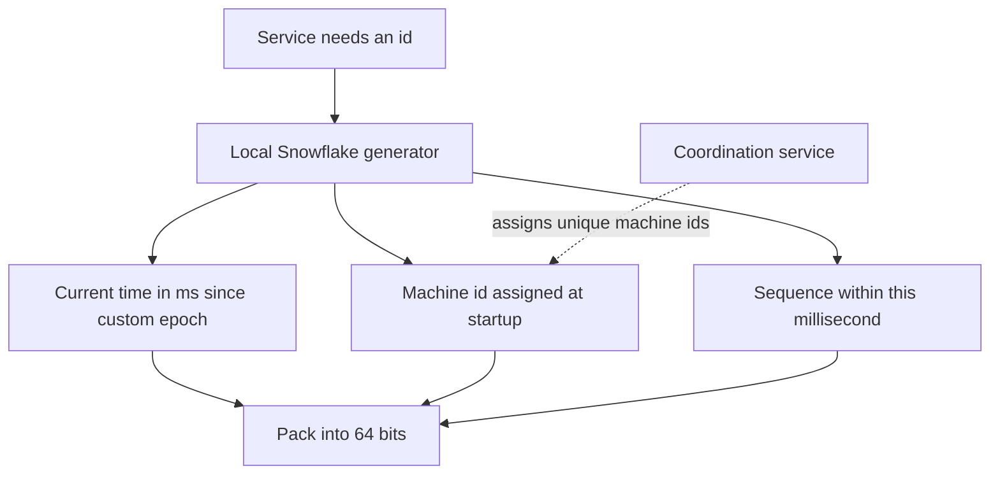

## The hook

Every tweet, order, message and payment needs an id. In a small app, the database's auto-increment column hands out 1, 2, 3 and nobody thinks about it. At thousands of writes per second across many database shards and data centres, that single counter becomes a bottleneck, a single point of failure, and a leak of business data: anyone can see how many orders you had yesterday.

Designing an id generator is a compact interview question that tests trade-offs between uniqueness, ordering, size, speed and failure behaviour.

:::analogy
Think of issuing ticket numbers at a huge exhibition with many entrance gates. One central ticket machine is simple but becomes a queue. Giving every gate its own pre-printed roll works, but tickets no longer show who arrived first. The clever compromise prints tickets that combine the time, the gate number and a counter: every gate works independently, numbers never clash, and sorting tickets roughly sorts arrival times.
:::

That compromise is the Snowflake design. We will build up to it.

## Requirements

**Functional**

1. Generate unique ids for new records, on demand, across many services and data centres.
2. Ids should be numeric and roughly sortable by creation time.

**Non-functional**

- Never produce a duplicate, even after crashes or restarts.
- High throughput, for example tens of thousands of ids per second, with very low latency, since id generation sits on every write path.
- Highly available: no single machine whose failure stops all writes.
- Compact: fit in 64 bits so they work as efficient database keys.
- Not trivially enumerable, so competitors cannot count your orders.

## Back-of-envelope numbers

All numbers are **estimates**.

- **Peak rate:** 50,000 ids per second across the system.
- **Lifetime:** the system should run for decades. A 41-bit millisecond timestamp covers 2⁴¹ ms ≈ 2.2 × 10¹² ms ≈ **69 years** from a chosen epoch.
- **Per-machine rate:** with 12 sequence bits, one machine can issue 2¹² = **4,096 ids per millisecond**, about 4 million per second, far more than needed.
- **Machines:** 10 bits of machine id allow **1,024** generators.
- **Size:** 1 + 41 + 10 + 12 = 64 bits, a single `bigint` column.

## High-level design

Four options, from simplest to most scalable:

| Option | How | Pros | Cons |
|---|---|---|---|
| Single DB [[auto-increment]] | next integer per row | simple, ordered | bottleneck, single point of failure, leaks counts |
| Ticket servers | dedicated DBs hand out ids, e.g. two servers issuing odd and even numbers | simple, numeric | still central, ordering between servers is loose |
| [[UUID]] | 128-bit random (v4) or time-ordered (v7) values generated locally | no coordination at all | 128 bits, v4 keys index poorly |
| [[Snowflake id]] | timestamp + machine id + sequence, generated locally | 64 bits, time-ordered, no per-id coordination | needs unique machine ids and sane clocks |



The recommended design: every app server (or a small sidecar) runs a Snowflake generator. A coordination service such as ZooKeeper or etcd, or simple configuration, assigns each generator a unique machine id at startup. After that, generating an id needs no network call at all.

## Deep dives

### 1. The Snowflake bit layout

```pseudo
| 1 bit unused | 41 bits: ms since epoch | 10 bits: machine id | 12 bits: sequence |
```

- The top bit stays 0 so ids are positive in signed 64-bit types.
- The timestamp counts milliseconds since a custom [[epoch]], such as the launch date, to stretch the 69 years.
- The machine id makes ids from different generators disjoint.
- The [[sequence number]] distinguishes ids within the same millisecond on the same machine.

Because the timestamp sits in the high bits, sorting ids sorts them by creation time, to millisecond precision, across all machines (with clocks roughly in sync).

### 2. Generating within one machine

```pseudo
next_id():
    now = current_ms()
    if now < last_ms: wait until now >= last_ms         // clock went backwards
    if now == last_ms:
        seq = (seq + 1) mod 4096
        if seq == 0: wait until the next millisecond     // used all 4096 this ms
    else:
        seq = 0
    last_ms = now
    return (now - EPOCH) << 22 | machine_id << 12 | seq
```

:::insight
Uniqueness comes from partitioning the id space so that no two generators can ever produce the same value: different machines differ in the machine bits, and the same machine differs in time or sequence. No per-id coordination is needed, which is what makes it fast and available.
:::

### 3. Assigning machine ids safely

Two generators with the same machine id would produce duplicates in the same millisecond. Assign ids from a coordination service with leases, or derive them from stable deployment slots, and fail startup if no id can be obtained.

### 4. Ordering, databases and privacy

Time-ordered ids insert near the end of B-tree indexes, keeping writes sequential and caches warm, unlike random UUID v4 keys, as discussed in [Why Some Queries Are Instant and Others Take Minutes](article:system-design-database-indexing). They also leak creation time, which is usually acceptable, but not the total count of records. Where even timing must be hidden, use random ids or encrypt ids before exposing them.

## Trade-offs

- **Coordination vs simplicity:** auto-increment is simplest but central; Snowflake needs machine-id assignment but nothing per id; UUIDs need no coordination at all.
- **Size:** 64-bit Snowflakes are compact; 128-bit UUIDs double key size in every index and foreign key.
- **Ordering strength:** Snowflake ordering is only as good as clock synchronisation, roughly ordered, not strictly; strict global order needs a central sequencer.
- **Time-ordered UUIDs (v7)** are a strong middle ground when 128 bits are acceptable: locally generated, sortable, no machine ids.

## What can go wrong

- **[[Clock skew]] or a clock jumping backwards** after NTP correction can produce duplicates if the generator reuses old timestamps; it must wait or refuse.
- **Duplicate machine ids** from misconfiguration produce duplicate ids; enforce uniqueness through a coordination service and alarms.
- **Sequence exhaustion** in a burst above 4,096 ids per millisecond per machine forces a wait, adding latency; add generators or sequence bits.
- **Epoch overflow** after about 69 years; choose the epoch close to launch and document it.
- **Leaking information**: sequential ids reveal volume, and time-ordered ids reveal timing; decide what is acceptable to expose.

:::warning
Common misconception: "UUIDs are random, so they are the best choice everywhere." Random UUID v4 keys are unique without coordination, but they are twice the size of a 64-bit id and scatter inserts across indexes. For high-volume primary keys, time-ordered ids such as Snowflake or UUID v7 usually perform better.
:::

:::try-this
Your generator uses 41 timestamp bits, 10 machine bits and 12 sequence bits. Product wants 4,000 generators. What would you change, and what does it cost? (4,000 needs 12 machine bits. Take 2 bits from the sequence, leaving 10 bits, 1,024 ids per millisecond per machine, still far more than one machine needs. Or take bits from the timestamp, shortening the lifetime.)
:::

### Interview follow-ups

**"Lay out a Snowflake-style 64-bit id."** 1 sign bit, 41 bits of milliseconds since a custom epoch (about 69.7 years), 10 bits of machine id (1,024 machines) and 12 bits of sequence (4,096 ids per millisecond per machine, about 4 million per second).

**"Why not UUIDs?"** A random UUID is 128 bits and unordered, so it bloats indexes and scatters inserts across a B-tree. Time-ordered ids sort roughly by creation time. Newer time-ordered UUID versions exist for the same reason.

**"Why not a database auto-increment?"** One database becomes a bottleneck and a single point of failure. Ranges or block allocation (each server reserves 1,000 ids at a time) help, but a coordination-free generator scales further.

## Further reading

- Twitter engineering, "Announcing Snowflake" (2010): https://blog.x.com/engineering/en_us/a/2010/announcing-snowflake
- Flickr engineering, "Ticket Servers: Distributed Unique Primary Keys on the Cheap" (2010): https://code.flickr.net/2010/02/08/ticket-servers-distributed-unique-primary-keys-on-the-cheap/
- RFC 9562, Universally Unique IDentifiers (UUIDs), including version 7: https://www.rfc-editor.org/rfc/rfc9562

## Key takeaways

- A single auto-increment counter is simple but becomes a bottleneck and single point of failure at scale.
- UUIDs need no coordination, but they are 128 bits, and random version 4 keys index poorly; version 7 adds time ordering.
- Snowflake ids pack a millisecond timestamp, a machine id and a sequence number into 64 bits, giving unique, roughly time-sorted ids generated locally.
- Uniqueness comes from partitioning the bit space, so machine ids must be unique and clocks must never be allowed to go backwards.
- Choose the bit split from your lifetime, machine count and per-millisecond rate requirements, and decide what timing information ids may reveal.
