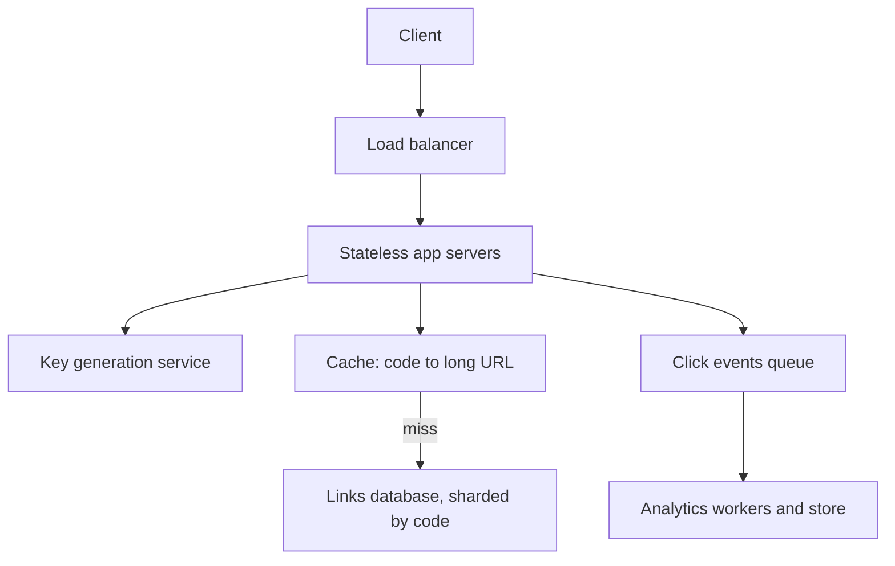

## The hook

A marketing team pastes a 300-character link into a campaign and gets back `sho.rt/aB3xY9k`. It looks like a trivial service: store a mapping, redirect on click. Then the link goes viral, receives millions of clicks an hour, and must keep working for years.

The URL shortener is the most common warm-up in system design interviews precisely because it is small enough to finish in 45 minutes, yet it touches the core skills: requirements, estimation, unique key generation, a read-heavy path, caching, and graceful failure.

:::analogy
Think of a cloakroom at a large theatre. You hand over a long, bulky coat and get a small numbered ticket. Later, anyone holding that ticket gets the coat back instantly. The cloakroom's whole job is to issue tickets that never clash, keep the coats safe for as long as promised, and hand them back quickly even when the whole audience leaves at once.
:::

The coat is the long URL, the ticket is the [[short code]], and the cloakroom is our service. We will keep coming back to the cloakroom.

## Requirements

**Functional**

1. Given a long URL, create a short link. Optionally accept a custom alias, such as `sho.rt/diwali-sale`.
2. Visiting a short link redirects to the long URL.
3. Links may have an expiry date.
4. Owners can see basic click statistics.

**Non-functional**

- Redirects must be fast, aiming for well under 100 ms at the server, because they sit in front of every click.
- Very high availability for redirects: a broken short link breaks someone's campaign.
- Codes must be unique and should not be trivially enumerable, so people cannot guess private links.
- The workload is [[read-heavy]]: far more clicks than new links.

**Out of scope for now:** link editing, user accounts beyond basic ownership, spam detection (mention it briefly).

## Back-of-envelope numbers

All numbers below are **estimates** chosen for the exercise.

- **New links:** 100 million per month. 100,000,000 / (30 × 86,400) ≈ 100,000,000 / 2.6 million ≈ **40 writes per second** average, maybe 400 at peak.
- **Redirects:** 100 reads per write ≈ **4,000 reads per second** average, perhaps 40,000 at peak during viral spikes.
- **Storage:** each record (code, long URL, owner, timestamps) ≈ 500 bytes. 100 million × 12 months × 5 years = 6 billion links × 500 B ≈ **3 TB** over five years, before replication.
- **Code length:** with [[base62]], 62⁷ ≈ 3.5 × 10¹² possible 7-character codes, far more than 6 billion. Six characters, 62⁶ ≈ 5.7 × 10¹⁰, would also suffice, but seven leaves room for growth and makes guessing harder.

What the numbers say: writes are modest; reads dominate and spike, so the redirect path needs caching; storage fits comfortably in a sharded key-value store or a partitioned relational database.

## High-level design

**API**

- `POST /links` with `{ long_url, custom_alias?, expires_at? }` → `201 { short_url }`
- `GET /{code}` → `302 Location: long_url` (or `404` if missing or expired)
- `GET /links/{code}/stats` → click counts

**Data model:** `links(code PRIMARY KEY, long_url, owner_id, created_at, expires_at)`. The only hot query is "look up by code", a perfect key-value access pattern.

**Write path:** an app server gets a fresh code from the [[key generation service]], stores the mapping, and returns the short URL.

**Read path:** an app server checks the cache for the code; on a miss it reads the database and fills the cache; it returns a redirect and publishes a click event to a queue without waiting for analytics.

## Deep dives

### 1. Generating unique codes

This is the heart of the question, and there are three standard options.

**Hash and truncate.** Compute a hash of the long URL, such as the first 7 Base62 characters of its SHA-256. Simple, and the same URL always maps to the same code. But truncation causes [[collision]]s; you must check the database and retry with a salt, which adds a read to every write and gets worse as the table fills.

**Counter plus Base62.** Keep a global counter; each new link takes the next number and encodes it. Unique by construction, no collision checks. Two concerns:

- *A single counter is a bottleneck and a single point of failure.* Fix: the key service hands each app server a block of ids, say 1,000 at a time, recorded in a strongly consistent store. Servers use their block locally and fetch another when it runs out. A crash wastes at most part of a block, which is fine.
- *Sequential codes are guessable.* Fix: apply a reversible scramble, such as a fixed bijective permutation of the id or a format-preserving encryption, before encoding, so consecutive ids produce unrelated-looking codes.

**Pre-generated keys.** A background job generates random unused codes into a pool table; app servers claim codes from it. Random and collision-free at claim time, at the cost of managing the pool.

:::insight
Uniqueness is easiest to guarantee at generation time, not by checking afterwards. Handing out disjoint blocks of ids to each server gives unique codes with almost no coordination, which is the same idea as the cloakroom giving each attendant their own roll of numbered tickets.
:::

**Custom aliases** use the same table: insert with a uniqueness constraint and return `409 Conflict` if taken. Keep aliases in a separate namespace or length range so they never collide with generated codes.

### 2. The redirect path

At peak, tens of thousands of redirects per second hit mostly popular links. A shared cache (code → long URL) with an LRU policy and a TTL handles the hot set; a small in-process cache on each server can absorb the very hottest viral links. Because mappings rarely change, cache entries can live for hours. Expired links are removed from the cache when they expire or on deletion.

[[301 vs 302 redirect]]: 301 lets browsers cache the redirect, reducing load but hiding repeat clicks from analytics. A product that sells click statistics usually returns 302.

### 3. Analytics without slowing redirects

Counting clicks synchronously would put a database write on every redirect. Instead, the server publishes a small event (code, timestamp, country, referrer) to a message queue and returns immediately. Workers aggregate counts per link per hour into an analytics store. If the analytics pipeline lags, redirects are unaffected, as in [The Ticket Rail Between Waiters and Cooks](article:system-design-message-queues).

### 4. Storage and expiry

Shard the links table by code; since codes are random-looking, load spreads evenly. Expired links can be deleted lazily: check `expires_at` on read and return 404, and run a periodic job to purge old rows and free codes if reuse is desired (usually it is not, to avoid sending old clicks to new owners).

## Trade-offs

| Decision | Option A | Option B |
|---|---|---|
| Code generation | hashing: same URL, same code; needs collision checks | counter blocks: unique, fast; needs a coordinator and scrambling |
| Redirect type | 301: fewer requests, less analytics | 302: every click counted, more load |
| Analytics | synchronous: exact, slows redirects | asynchronous: fast, slightly delayed counts |
| Database | key-value store: scales easily for lookups by code | relational: easier ad-hoc queries for owners' dashboards |

Deduplication is a product choice: should two users shortening the same URL get the same code? Usually no, because each owner wants separate statistics and control.

## What can go wrong

- **Key service outage:** new links cannot be created. Mitigate with replicated coordination storage and by letting servers prefetch a spare block, so they keep working for a while.
- **Cache failure:** all reads fall to the database at once. Size the database for a partial cache loss, use cache replicas, and warm caches gradually.
- **Hot viral link:** one code receives a huge share of traffic. A local in-process cache on every app server and a CDN-level cache for the redirect absorb it.
- **Abuse:** shortened links used for phishing or spam. Add rate limits per user, URL safety checks on creation, and the ability to disable codes quickly.
- **Data loss:** losing mappings breaks links forever, so the links table needs replication and backups, unlike the cache.

:::warning
Common misconception: "hash the URL and take the first 7 characters, done." Truncated hashes collide, and the collision rate grows as the table fills. Any hash-based design needs a collision check and retry, which is why counter-based designs with scrambling are often simpler at scale.
:::

:::try-this
Your counter-based design gives each server blocks of 1,000 ids. There are 50 servers and each restarts once a day, wasting on average half a block. How many ids are wasted per year, and does it matter? (About 50 × 500 × 365 ≈ 9 million ids per year, a negligible fraction of 3.5 trillion possible codes. Wasting ids is a fine price for avoiding coordination.)
:::

### Interview follow-ups

**"How many links do 7 base-62 characters give?"** 62⁷ ≈ 3.5 trillion, versus about 57 billion for 6 characters. Show the arithmetic, then compare with your estimate of links created per year.

**"301 or 302 redirect?"** 301 (permanent) lets browsers cache the redirect, which cuts load but hides repeat clicks from your analytics. 302 (temporary) sends every click through your service, so you can count them and change the target.

**"Hash the long URL or use a counter?"** Hashing makes the same URL map to the same code but needs collision handling. A counter encoded in base 62 never collides but makes codes guessable, so many designs shuffle or encrypt the counter value first.

## Further reading

- Martin Kleppmann, *Designing Data-Intensive Applications*, chapter 6 on partitioning (O'Reilly, 2017).
- MDN Web Docs, "Redirections in HTTP": https://developer.mozilla.org/en-US/docs/Web/HTTP/Redirections

## Key takeaways

- A URL shortener is a read-heavy key-value lookup, so the design centres on fast, cached redirects.
- Unique codes are easiest with a counter encoded in Base62, served in blocks per server and scrambled so codes are not guessable.
- Hash-and-truncate is simple but needs collision checks that get more expensive as the table fills.
- Choose 302 redirects when click analytics matter, and record clicks asynchronously through a queue.
- Plan for key-service outages, cache failures, viral hot links and abuse, and replicate the mapping table because losing it breaks links forever.
