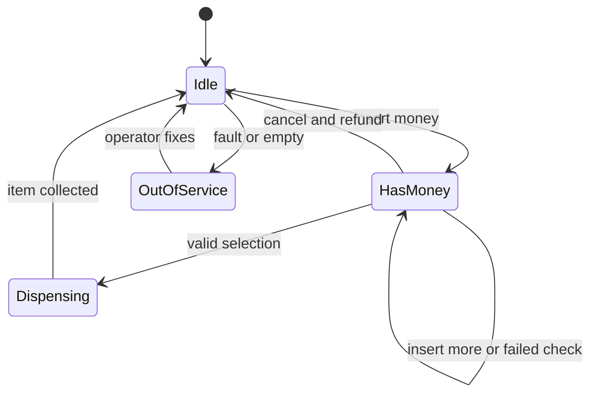
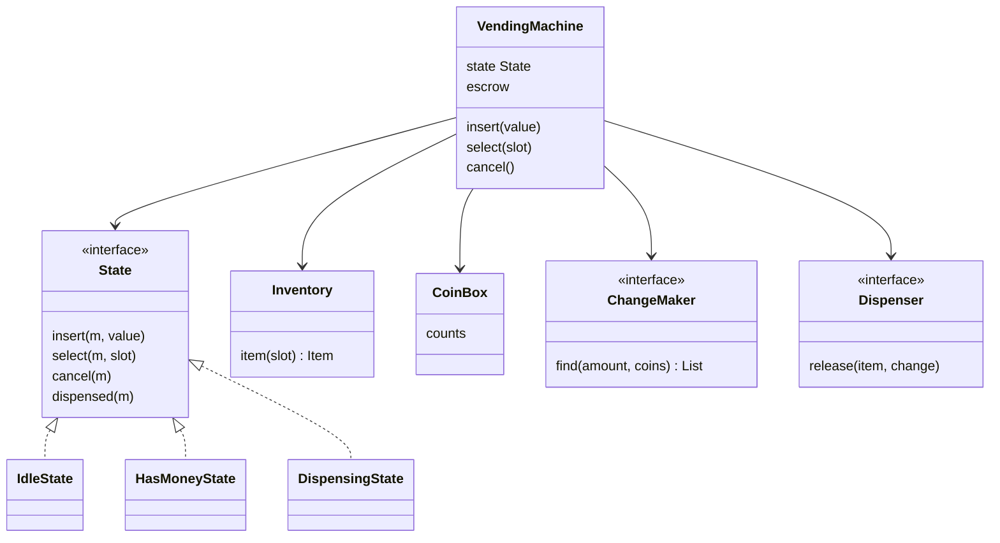

## The hook

A railway platform at 6 am. You feed a ₹20 note into a snack machine and press the button for ₹14 chips. The machine whirs, thinks, and spits your note back out with a message: "Exact change only".

You are annoyed. But think about what happened inside.

The machine needed to give you ₹6. Its coin box had one ₹5 coin and three ₹2 coins, no ₹1s. Predict what a simple "take the biggest coin that fits" rule does here. It grabs the ₹5, needs ₹1, finds none, and gives up, even though 2 + 2 + 2 was sitting right there.

So a vending machine, the textbook example of "just use the State pattern", hides a real algorithm and a real transaction. Here is how to design one that behaves correctly in every mood it can be in.

## Requirements

**Functional**

- Slots hold items with a price and a quantity.
- Accepts ₹1, ₹2, ₹5 and ₹10 coins and ₹20 notes; gives change in coins only.
- The customer inserts money, selects an item, gets the item and change.
- Cancel at any point before dispensing returns the money inserted.
- Handle: sold-out item, not enough money, change impossible.
- An operator can restock items and coins.

**Non-functional**

- Never lose a customer's money and never give away an item unpaid.
- New states (out of service, maintenance) must slot in without rewriting existing ones.
- Testable without hardware: the motor and coin acceptor sit behind interfaces.

:::analogy
Think of the machine as having **moods**. When it is *sleepy* (idle), pressing a product button gets a sleepy "insert money first". When it is *attentive* (has money), the same button starts a sale. When it is *busy* (dispensing), it ignores buttons and politely returns any coin you push in. The buttons never change; the machine's mood decides what each one means.
:::

## Core objects

- **VendingMachine**: the context. Holds inventory, the coin box, the escrow and the current state.
- **State** with **IdleState**, **HasMoneyState**, **DispensingState** (and later **OutOfServiceState**).
- **Inventory** of slots: item name, price, quantity.
- **CoinBox**: coin counts available for change.
- **ChangeMaker**: finds coins for an amount from the box.
- **Dispenser** and **MoneyAcceptor**: hardware interfaces, faked in tests.

Wait, why is the customer's money kept in a separate [[escrow]] instead of being added to the coin box straight away? Because cancel must always succeed. If inserted coins were mixed into the box, a refund would become a change-making problem that might fail. Escrow keeps the customer's own coins aside until the sale is final.

## Class design

### The giant if-else, before

Here is how this usually starts:

```pseudo
selectItem(slot):
    if state == IDLE: show "insert money first"
    else if state == HAS_MONEY:
        if item sold out: ...
        else if balance < price: ...
        else: dispense; state = DISPENSING
    else if state == DISPENSING: show "busy"
    else if state == OUT_OF_SERVICE: ...

insertMoney(v):
    if state == IDLE: ...
    else if state == HAS_MONEY: ...
    else if state == DISPENSING: ...     // same four branches again
```

Three events times four states is twelve branches, scattered across three methods. Adding a maintenance state means finding and editing every one, and missing one means a coin swallowed during maintenance.

### The State pattern, after

With the [[State pattern]], each mood becomes a class, and each class must answer every event. The machine just forwards: `state.insert(this, v)`.

```pseudo
interface State:
    insert(machine, value)
    select(machine, slot)
    cancel(machine)
    dispensed(machine)              // hardware callback

class IdleState implements State:
    insert(m, v):  m.escrow.add(v); m.state = HasMoney
    select(m, s):  show "insert money first"
    cancel(m):     show "nothing to refund"

class HasMoneyState implements State:
    insert(m, v):  m.escrow.add(v)
    select(m, s):
        item = m.inventory[s]
        if item.qty == 0:             show "sold out"; return        // stay
        if m.balance < item.price:    show "need more"; return       // stay
        change = m.changeMaker.find(m.balance - item.price, m.coinBox + escrow coins)
        if change is NONE:            show "cannot make change"; return
        // commit point: nothing below can fail for business reasons
        m.coinBox.add(escrow coins); m.coinBox.remove(change)
        m.escrow.clear(); item.qty -= 1
        m.dispenser.release(item, change)
        m.state = Dispensing
    cancel(m):     return m.escrow contents; m.escrow.clear(); m.state = Idle

class DispensingState implements State:
    insert(m, v):  return the coin; show "busy"
    select(m, s):  show "busy"
    cancel(m):     show "too late to cancel"
    dispensed(m):  m.state = Idle
```



Each arrow is a [[transition]] owned by the state it leaves. Notice the self-loop on HasMoney: sold out, not enough money and no change all leave the machine attentive, waiting for the next move. That is the machine's mood at work: a failed selection does not make it forget your money.



## Key flows

### The change problem nobody expects

Back to the platform. The machine owes ₹6, and the box holds one ₹5 and three ₹2 coins.

| Approach | Steps | Result |
|---|---|---|
| [[Greedy algorithm|Greedy]], largest coin first | take 5, remaining 1; no 1 or smaller coin left | fails, note returned |
| Search over the box | try 2 + 2 + 2 | ₹6 in three coins |

Greedy is the right answer for the Indian coin system when the supply is unlimited; for 6 it would give 5 + 1. A real machine has a **limited** box, and that breaks the guarantee. This is the bounded [[change-making problem]], and with amounts of a few hundred rupees and four coin types, a tiny dynamic programme solves it instantly:

```pseudo
find(amount, box):          // box: list of (coin value, count)
    best[0][0] = 0, everything else infinity
    for each denomination i with value v and count n:
        for a from 0 to amount:
            for c from 0 to n while c * v <= a:
                best[i][a] = min(best[i][a], best[i-1][a - c*v] + c)   // remember c
    if best[last][amount] is infinity: return NONE
    walk back through the remembered counts to list the coins
```

The work is denominations × amount × coins per denomination, a few thousand steps at most for any snack price.

:::insight
The State pattern makes a vending machine's behaviour easy to change, but correctness comes from the transaction: every check that can fail (stock, balance, change) runs before one commit point, and the customer's money waits in escrow until then.
:::

### A morning at the machine, traced

Slots: A1 chips ₹14 (2 left), A2 juice ₹25 (1 left), A3 biscuits ₹12 (sold out). Coin box: ₹10 ×1, ₹5 ×1, ₹2 ×3, ₹1 ×0.

| Step | Mood before | Event | What happens | Mood after |
|---|---|---|---|---|
| 1 | Idle | select A1 | "insert money first" | Idle |
| 2 | Idle | insert ₹10 coin | balance 10 | HasMoney |
| 2 | HasMoney | select A1 | "need 4 more" | HasMoney |
| 3 | HasMoney | insert ₹10 coin | balance 20 | HasMoney |
| 3 | HasMoney | select A1 | change 6 = 2 + 2 + 2; escrow coins join box; chips released | Dispensing |
| 4 | Dispensing | insert ₹5 coin | "busy", coin returned | Dispensing |
| 4 | Dispensing | item collected | | Idle |
| 5 | Idle | insert ₹20 note | balance 20 | HasMoney |
| 5 | HasMoney | select A3 | "sold out" | HasMoney |
| 5 | HasMoney | select A1 | change 6 impossible: box now has ₹10 ×3, ₹5 ×1, no ₹2 or ₹1 | HasMoney |
| 5 | HasMoney | cancel | refund the same ₹20 note | Idle |
| 6 | Idle | insert ₹20 note, then ₹5 coin | balance 25 | HasMoney |
| 6 | HasMoney | select A2 | exact, no change; juice released | Dispensing |
| 6 | Dispensing | item collected | | Idle |

Final coin box: ₹10 ×3, ₹5 ×2, ₹2 ×0, ₹1 ×0. Before you read on, can you spot why step 5 failed when step 3 succeeded for the very same chips? Step 3 spent all three ₹2 coins. The same item, the same price and the same ₹20 now have different outcomes because the box changed, which is exactly why the change check must run on every sale.

:::try-this
After step 6, the box holds ₹10 ×3 and ₹5 ×2. A customer inserts two ₹10 coins and selects chips at ₹14. Can the machine sell? (No. The change is ₹6, and even counting the inserted ₹10 coins the available coins are only ₹10s and ₹5s, which cannot make 6. The machine stays in HasMoney and the customer can cancel to get both ₹10 coins back.)
:::

### The code

A compact version with one class per state, escrow, and the bounded change-maker. `main` replays the traced morning.

```cpp
#include <bits/stdc++.h>
using namespace std;

struct Item { string name; int price; int qty; };
struct VendingMachine;

struct State {                                   // every state answers every event
    virtual void insert(VendingMachine& m, int value) = 0;
    virtual void select(VendingMachine& m, const string& slot) = 0;
    virtual void cancel(VendingMachine& m) = 0;
    virtual void dispensed(VendingMachine&) {}
    virtual ~State() = default;
};

struct VendingMachine {
    map<string, Item> slots;
    map<int, int> coins;                         // coin value -> count available for change
    vector<int> escrow;                          // money inserted in this transaction
    State* state;
    State *idle, *hasMoney, *dispensing;
    int balance() const { return accumulate(escrow.begin(), escrow.end(), 0); }

    // Fewest coins for `amount` from a limited coin box, or nullopt if impossible.
    optional<vector<int>> makeChange(int amount, map<int, int> box) const {
        for (int v : escrow) if (v <= 10) box[v]++;  // inserted coins can be reused; notes cannot
        vector<pair<int, int>> d(box.begin(), box.end());   // (value, count)
        int k = d.size();
        const int INF = 1e9;
        // best[i][a]: fewest coins for amount a using the first i denominations; use[i][a]: how many of coin i.
        vector<vector<int>> best(k + 1, vector<int>(amount + 1, INF)), use(k + 1, vector<int>(amount + 1, 0));
        best[0][0] = 0;
        for (int i = 1; i <= k; ++i)
            for (int a = 0; a <= amount; ++a)
                for (int c = 0; c <= d[i - 1].second && c * d[i - 1].first <= a; ++c)
                    if (best[i - 1][a - c * d[i - 1].first] + c < best[i][a]) {
                        best[i][a] = best[i - 1][a - c * d[i - 1].first] + c; use[i][a] = c;
                    }
        if (best[k][amount] == INF) return nullopt;
        vector<int> out;
        for (int i = k, a = amount; i > 0; a -= use[i][a] * d[i - 1].first, --i)
            for (int c = 0; c < use[i][a]; ++c) out.push_back(d[i - 1].first);
        return out;
    }
};

struct IdleState : State {
    void insert(VendingMachine& m, int v) override {
        m.escrow.push_back(v); m.state = m.hasMoney;
        cout << "  inserted " << v << ", balance " << m.balance() << "\n";
    }
    void select(VendingMachine&, const string&) override { cout << "  insert money first\n"; }
    void cancel(VendingMachine&) override { cout << "  nothing to refund\n"; }
};

struct HasMoneyState : State {
    void insert(VendingMachine& m, int v) override {
        m.escrow.push_back(v); cout << "  inserted " << v << ", balance " << m.balance() << "\n";
    }
    void select(VendingMachine& m, const string& slot) override {
        Item& it = m.slots.at(slot);
        if (it.qty == 0) { cout << "  " << it.name << " sold out, pick another or cancel\n"; return; }
        if (m.balance() < it.price) { cout << "  need " << it.price - m.balance() << " more\n"; return; }
        auto change = m.makeChange(m.balance() - it.price, m.coins);
        if (!change) { cout << "  cannot make change for " << m.balance() - it.price << ", cancel or pick another\n"; return; }
        // Commit: inserted coins join the box, change leaves it, item count drops.
        for (int v : m.escrow) if (v <= 10) m.coins[v]++;
        for (int c : *change) m.coins[c]--;
        m.escrow.clear(); it.qty--;
        cout << "  dispensing " << it.name << ", change:";
        for (int c : *change) cout << " " << c;
        cout << (change->empty() ? " none" : "") << "\n";
        m.state = m.dispensing;
    }
    void cancel(VendingMachine& m) override {
        cout << "  refund:";
        for (int v : m.escrow) cout << " " << v;     // the same coins and notes, not "change"
        cout << "\n"; m.escrow.clear(); m.state = m.idle;
    }
};

struct DispensingState : State {
    void insert(VendingMachine&, int v) override { cout << "  busy, returned " << v << "\n"; }
    void select(VendingMachine&, const string&) override { cout << "  busy\n"; }
    void cancel(VendingMachine&) override { cout << "  busy, too late to cancel\n"; }
    void dispensed(VendingMachine& m) override { cout << "  item collected\n"; m.state = m.idle; }
};

int main() {
    IdleState idle; HasMoneyState has; DispensingState disp;
    VendingMachine m;
    m.idle = &idle; m.hasMoney = &has; m.dispensing = &disp; m.state = &idle;
    m.slots = {{"A1", {"Chips", 14, 2}}, {"A2", {"Juice", 25, 1}}, {"A3", {"Biscuits", 12, 0}}};
    m.coins = {{1, 0}, {2, 3}, {5, 1}, {10, 1}};

    cout << "1\n"; m.state->select(m, "A1");
    cout << "2\n"; m.state->insert(m, 10); m.state->select(m, "A1");
    cout << "3\n"; m.state->insert(m, 10); m.state->select(m, "A1");   // 20 for 14: change 6
    cout << "4\n"; m.state->insert(m, 5); m.state->dispensed(m);
    cout << "5\n"; m.state->insert(m, 20); m.state->select(m, "A3"); m.state->select(m, "A1"); m.state->cancel(m);
    cout << "6\n"; m.state->insert(m, 20); m.state->insert(m, 5); m.state->select(m, "A2"); m.state->dispensed(m);
    cout << "coins left:";
    for (auto [v, n] : m.coins) cout << " " << v << "x" << n;
    cout << "\n";
}
```

The output matches the table: change `2 2 2` at step 3, "cannot make change for 6" at step 5, refund of the same 20, and the final box `1x0 2x0 5x2 10x3`.

:::warning
Common misconception: "the State pattern alone makes the machine correct." It removes the if-else tangle, but correctness still depends on ordering inside a state. If HasMoneyState decremented the item and cleared escrow before checking change, a failed change check would leave the customer with no money and no item. Put every fallible check before the commit point.
:::

## Patterns used

| Pattern | Where | Why |
|---|---|---|
| State | Idle, HasMoney, Dispensing, OutOfService | Same buttons, different meaning per mood; a new mood is a new class |
| Strategy | ChangeMaker | Greedy is fine for a well-stocked box; the bounded search handles the rest; a "fewest coins" or "keep small coins" policy can swap in |
| Dependency injection | Dispenser and MoneyAcceptor interfaces | Tests use fakes, so the whole morning above runs without hardware |
| Observer | Telemetry listening to sales and low-stock events | An operator dashboard can subscribe without the machine knowing it |

## Extensions

### When the motor jams

The item is committed, but the spiral jams and nothing falls. That is a partial dispense failure. The dispenser reports failure through its callback; DispensingState refunds the price from the coin box (or records a credit if change is impossible), restores the item count, and moves the machine to OutOfService so the next customer does not lose money too.

### Two things happening at once

A real machine gets events from the coin acceptor, the keypad and the motor at the same time, often on different threads or interrupts. If a coin event and a select event interleave inside HasMoneyState, the balance read by select may miss the coin. The usual answer is to push every event onto one queue and let a single loop apply them to the current state in order, which keeps every transition atomic without locks inside the states. Remote restocking goes through the same queue, and only in Idle or OutOfService.

### Common mistakes

- **One giant switch on a state enum**, which grows with every state and event.
- **Floating-point money.** Keep integer rupees or paise.
- **Greedy change with a limited box**, which fails in cases like ₹6 from 5, 2, 2, 2.
- **Refunding by computing change** instead of returning escrow.
- **States that forget to handle an event**, which is why the interface forces every state to answer every event.

### Interview follow-ups

**"How do you add card or UPI payment?"** Add a PaymentMethod strategy. Cash goes through escrow; a card payment is authorised for the item price only after the selection passes stock checks, and captured at the commit point. The states do not change; HasMoney simply means "payment authorised or cash in escrow".

**"Should states be singletons?"** Stateless state objects can be shared, so one instance of each per machine (or even per process) is fine. Keep the data, such as balance and escrow, in the machine, never inside the state objects.

**"How would you let an operator restock safely?"** Add a Maintenance state entered with an operator key. In Maintenance, customer events are rejected and restock events are accepted; leaving Maintenance returns to Idle. No existing state changes.

**"What is the complexity of your change-maker?"** Proportional to denominations × amount × maximum coins per denomination. With four coin types and amounts under a few hundred, that is tiny, so a precise search is affordable on every sale.

Next in this track, [Design Splitwise](article:system-design-splitwise) leaves the single machine behind for a shared ledger, where money correctness and a clever simplification step are the whole interview.

## Key takeaways

- A vending machine is a state machine, and the State pattern turns each mood (idle, has money, dispensing) into a class that answers every event, so new states never require editing a giant switch.
- Every check that can fail, including stock, balance and change, must run before a single commit point, so a failed sale leaves the customer's money and the inventory untouched.
- Keeping inserted money in escrow makes cancel always succeed, because a refund returns the same coins instead of solving a change problem.
- Greedy change-making is optimal for Indian denominations only with an unlimited supply, so a real coin box needs a small bounded search that finds combinations such as 2 + 2 + 2.
- Route hardware events through one queue so each transition applies atomically to the current state.
