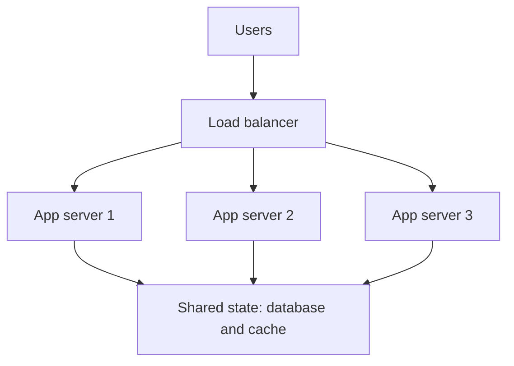

## The hook

It is 9:58 on result day. Your exam-results site normally sees a few hundred visitors a minute. In two minutes, every student in the state will press refresh at once.

You have two levers. You can rent a monster machine with ten times the cores and memory. Or you can rent ten ordinary machines and spread the crowd across them. Both cost money. Only one of them can save you on the day the crowd is a hundred times bigger.

Guess which one most large websites end up with, and why it is not simply "the cheaper one". Hold that thought; the real reason has to do with what happens when one of the machines dies at 10:01.

## The intuition

:::analogy
You need to pull a heavy cart. You can buy **one stronger horse**, or hitch **a team of horses**. The strong horse is easy: one harness, one driver, no arguments. But horses only grow so big, a champion costs far more than two ordinary ones, and if it goes lame the cart stops. A team can grow almost without limit and keeps moving if one horse limps. But now someone must keep the horses pulling in the same direction, and that coordination is real work.
:::

That is the whole topic in one picture.

- **[[Vertical scaling]]** (scaling up) is the stronger horse: a bigger machine with more CPU, memory and faster disks.
- **[[Horizontal scaling]]** (scaling out) is the team: more machines sharing the load, usually behind a load balancer.

Neither is "right". Good designs use both, in different places, for different reasons. The skill an interviewer checks is knowing which lever to pull for which part of the system.

## How it works

### Scaling up: the stronger horse

You stop the server, move to a larger instance type, start it again. Your code does not change. Your database keeps all its data in one place, so joins, transactions and unique constraints keep working exactly as before.

That simplicity is the selling point. Wait, why is it so valuable? Because every distributed-systems problem you will meet later (replication lag, split brain, cross-shard joins) simply does not exist on one machine.

The walls you eventually hit:

- **A ceiling.** The biggest machine you can rent or buy is finite. Past it, there is no "next size".
- **Price grows faster than power.** The largest machines carry a premium per unit of capacity compared with mid-sized ones (check your provider's price list; the shape is consistent even though the numbers change).
- **One box is one failure.** A [[single point of failure]] takes everything down when it crashes, and upgrades often mean downtime.
- **Diminishing returns inside the box.** More cores only help if the software can use them in parallel.

### Scaling out: the team of horses

You run many copies of the server and put a load balancer in front, as in [The Host Who Seats Every Guest](article:system-design-load-balancers). Need more capacity? Add copies. One dies? The load balancer stops sending it traffic and the others carry on.

Look at the bottom of that diagram. Every app server talks to the same shared state. That is not an accident; it is the price of admission.

### The stateless requirement

Predict what happens here before reading on. A user logs in on server 1, which stores their session in its own memory. Their next request goes to server 2.

Server 2 has never heard of them. They are logged out, or their cart is empty, and it happens randomly depending on which server the load balancer picks.

:::insight
Horizontal scaling works only when any server can handle any request. That means app servers must be **stateless**: sessions, carts and uploads live in shared stores (a database, a cache such as Redis, object storage), not in one server's memory or local disk.
:::

A [[stateless server]] is what makes the team of horses interchangeable. [Pressing the Pay Button Twice Should Charge Once](article:system-design-stateless-idempotency) goes deeper on how to get there.

"Sticky sessions", where the load balancer always sends a user to the same server, look like a shortcut. They work until that server dies or you scale down, and then those users lose their state anyway. Treat them as a temporary crutch, not a design.

### Coordination: the hidden tax of going wide

Here is the trap the brief warns about. Adding machines does not add capacity one-for-one, because machines must coordinate: share locks, keep caches consistent, agree on who owns what.

[[Amdahl's law]] gives the cleanest way to see it. If a fraction s of each request's work cannot be spread out (say it runs under one global lock), the best possible speed-up with N workers is 1 / (s + (1 − s)/N). Never more than 1/s.

Take s = 5%, an innocent-looking global counter or lock:

| Servers N | Speed-up 1 / (0.05 + 0.95/N) | Ideal |
|---|---|---|
| 1 | 1.0x | 1x |
| 2 | 1.9x | 2x |
| 4 | 3.48x | 4x |
| 8 | 5.93x | 8x |
| 16 | 9.14x | 16x |
| 32 | 12.55x | 32x |
| 64 | 15.42x | 64x |

Sixty-four servers, about fifteen times the throughput, and a hard ceiling of 20x. The [[coordination cost]] did that, not the servers. Real systems can even get slower past some point, because every new node adds more cross-talk.

:::warning
Common misconception: "horizontal scaling is linear: twice the servers, twice the capacity." Only the parts with no shared state scale nearly linearly. Anything that needs agreement (a global lock, a single database primary, a shared counter, cache invalidation across nodes) caps the gain. Find and remove those shared parts first.
:::

## Trade-offs

| | Scale up (vertical) | Scale out (horizontal) |
|---|---|---|
| Code changes | None | Servers must be stateless; data may need partitioning |
| Ceiling | Largest machine available | Very high, limited by coordination |
| Cost curve | Premium for the biggest sizes | Roughly linear in machines, plus operational overhead |
| Failure | One box down means outage | Lose one of many; others absorb it |
| Upgrades | Often need downtime | Rolling deploys, one machine at a time |
| Consistency | Easy: one copy of the data | Harder: replication, partitioning, agreement |
| Best fit | Databases, stateful systems, early-stage products | Stateless web and API tiers, queue workers, caches |

A typical real system mixes both:

- **Stateless tiers scale out.** Web servers, API servers and background workers are the easy wins.
- **The database scales up first**, often for a long time, then adds read replicas, and only then splits data across machines (partitioning). Each step adds coordination, so you take it only when the previous one runs out.

### A back-of-envelope sizing

These numbers are **estimates** for illustration, not measurements. Suppose one app server handles about 2,000 requests per second and your result-day peak is 50,000 requests per second.

- Raw need: 50,000 / 2,000 = 25 servers.
- Run servers at about 70% utilisation so a spike or a dead server does not tip you over: 25 / 0.7 ≈ 35.7, so **36 servers**.
- Check the shared parts: can the database take the reads those 36 servers send it? If not, add a cache before adding more app servers, as in [Keep the Spices on the Counter](article:system-design-caching).

:::try-this
Your API tier is 10 servers at 60% CPU at peak. Traffic is forecast to grow 2.5x. Keeping the 70% utilisation target, how many servers do you need? (Current load is 10 × 0.6 = 6 servers' worth. At 2.5x that is 15 servers' worth. At 70% utilisation: 15 / 0.7 ≈ 21.4, so 22 servers. Then ask what the database will see at 2.5x, because that is usually the real bottleneck.)
:::

## What can go wrong

- **Hidden state** breaks scale-out: local file uploads, in-memory sessions, a cron job that runs on "the" server and now runs on all of them at once.
- **The database becomes the wall.** You scaled the app tier to 50 servers; all of them hammer one primary. Connection limits and write throughput hit first.
- **Thundering reconnects.** A deploy restarts every server at once and they all open database connections together. Roll deploys gradually.
- **Autoscaling too slowly.** New machines take minutes to boot and warm up; a spike that peaks in 30 seconds is over before they help. Keep headroom, pre-scale for known events like result day.
- **Scaling up into a corner.** A product that grew on one huge database with cross-table transactions everywhere can be painful to split later. Keep module boundaries clean even while you run on one box.

### Interview follow-ups

**"When would you choose vertical scaling in an interview answer?"** For the stateful core, usually the primary database, early on: it keeps transactions and joins simple. Say you would monitor headroom and add read replicas, caching, then partitioning as it fills.

**"How do you make a stateful app horizontally scalable?"** Move every piece of per-user state out of the server: sessions to a shared cache or signed tokens, files to object storage, scheduled jobs to a single scheduler or a queue. Then any server can serve any request.

**"What limits horizontal scaling?"** Shared, serial work: one database primary, global locks, cache invalidation across nodes, and network calls between services. Amdahl's law shows that even 5% serial work caps the speed-up at 20x.

**"What is the difference between scaling and elasticity?"** Scaling is being able to handle more load by adding resources. Elasticity is adding and removing them automatically as load changes, so you pay only for what you use.

## In the real world

- **Web and API tiers** in almost every large product run as many identical stateless instances behind load balancers, with autoscaling rules based on CPU or request rate.
- **Relational databases** commonly run on one large primary for a long time, with replicas for reads; partitioning comes when writes or data size outgrow the biggest practical machine.
- **Caches and queues** (Redis clusters, Kafka) scale out by splitting keys or partitions across nodes, which is why they talk about shards and partitions from day one.

The journey from one machine to many is told end to end in [From One Food Stall to a Restaurant Chain](article:system-design-scaling-journey). The next step is how the database itself goes wide, starting with read replicas and then partitioning, and every one of those steps trades simplicity for capacity, exactly like swapping the strong horse for a team.

## Further reading

- The Twelve-Factor App, the "Processes" and "Disposability" factors: the classic argument for stateless processes.
- Gene Amdahl's 1967 paper on the limits of parallel speed-up, the source of Amdahl's law.
- Your cloud provider's instance pricing page: compare the price per core of a mid-sized and the largest instance type yourself.

## Key takeaways

- Vertical scaling buys a bigger machine with no code changes, but it has a ceiling, gets expensive at the top, and leaves a single point of failure.
- Horizontal scaling adds machines behind a load balancer and survives failures, but it requires stateless servers and shared stores for all per-user data.
- Coordination is the hidden tax of going wide: any serial or shared work caps the speed-up, as Amdahl's law shows.
- Real systems mix both: stateless tiers scale out early, while the database usually scales up first and goes wide in deliberate steps.
- Size with estimates and headroom (for example 70% utilisation), and always check what the extra servers will do to the shared database.
