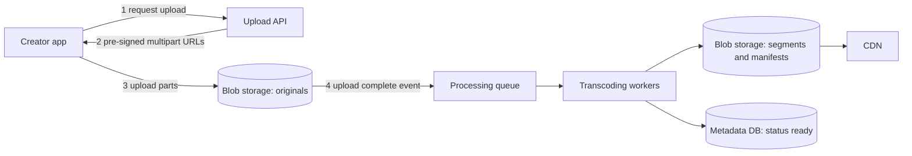
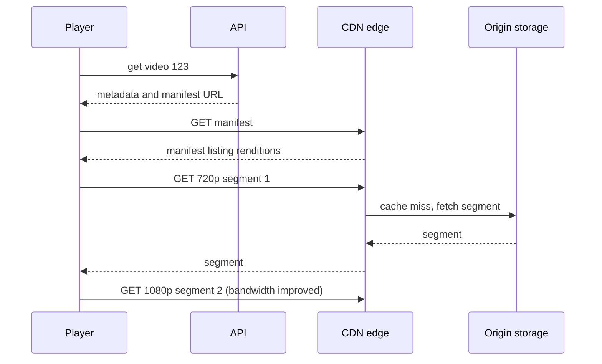

## The hook

You press play on a video and it starts almost instantly. Halfway through, your train enters a tunnel and the picture turns a little blurry instead of freezing, then sharpens again when the signal returns. Meanwhile, somewhere, a creator just uploaded a 4K video from a phone, and within minutes it is watchable on a smart TV, a laptop and a cheap phone on a slow network.

"Design YouTube" or "design Netflix" is a classic system design question because it has two very different halves: a heavy, batch-style **upload and processing pipeline**, and a massive, latency-sensitive **playback** path where the dominant cost is bandwidth.

:::analogy
Think of a film studio in the days of physical reels. A director delivers one master copy. The studio's lab makes many prints: big ones for luxury cinemas, smaller ones for village halls. The prints are cut into numbered reels and shipped to local cinemas all over the country, so audiences never wait for a reel to travel from the studio. A projectionist who finds the hall's equipment struggling can switch to a smaller print at the next reel change, without stopping the film.
:::

The master copy is the upload, the lab is the [[transcoding]] pipeline, prints are [[rendition]]s, reels are [[segment]]s, local cinemas are CDN edge servers, and the projectionist switching prints is [[adaptive bitrate streaming (ABR)]].

## Requirements

**Functional**

1. Users upload videos; the system processes them into playable formats.
2. Users watch videos on many devices and network speeds, with seeking.
3. Video metadata: title, description, creator, thumbnails; plus view counts.

**Non-functional**

- Playback starts fast and rarely stalls; quality adapts to the network.
- Uploads are reliable for large files on flaky connections.
- Highly available and globally distributed; cost-efficient bandwidth.
- Processing can take minutes; it does not need to be instant.

Out of scope: recommendations, comments, live streaming and DRM details.

## Back-of-envelope numbers

All numbers are **estimates**.

- **Uploads:** 500,000 videos per day, averaging 5 minutes and 300 MB as uploaded: **150 TB per day** of originals, about **14 Gbps** of average upload traffic.
- **Storage:** assume all renditions together take about as much space as the original: about 300 TB per day, roughly **110 PB per year** before replication.
- **Processing:** 500,000 × 5 minutes ≈ **42,000 hours of video per day** to transcode into several renditions.
- **Viewing:** 100 million daily viewers × 5 videos × 5 minutes ≈ 1.5 × 10¹¹ seconds watched per day, so about **1.7 million concurrent viewers** on average. At an average 3 Mbps that is about **5 Tbps** of egress, with higher peaks.
- **View events:** 500 million views per day ≈ **5,800 per second** on average.

The playback bandwidth dwarfs everything else, so the design is shaped around the CDN.

## High-level design

**Upload path**

1. The creator's app asks for an upload; the API creates a metadata row with status "uploading" and returns pre-signed multipart URLs, as described in [The Cloakroom That Never Loses a Coat](article:system-design-blob-storage).
2. The original goes directly to blob storage, never through app servers.
3. An event triggers the processing pipeline. When it finishes, the video's status becomes "ready".

**Playback path**

App servers hand out metadata and the [[manifest]] URL; every byte of video comes from the CDN, as in [Local Warehouses for the Whole Internet](article:system-design-cdn).

## Deep dives

### 1. The transcoding pipeline

Processing is a [[DAG (directed acyclic graph)]] of tasks:

1. Validate and inspect the original (format, duration, resolution).
2. Split the video into chunks of a few seconds, so many workers can encode one video in parallel.
3. Encode each chunk into each rendition, such as 240p, 480p, 720p and 1080p at matching bitrates, with codecs like H.264 for compatibility or newer ones like VP9 and AV1 for better compression.
4. Package into segments and write manifests for HLS and DASH.
5. In parallel: generate thumbnails, extract audio, run content checks.

Workers pull tasks from a queue, so a burst of uploads simply makes the queue longer; the pipeline scales by adding workers. Each task is idempotent and retried on failure, and the video is marked ready only when all required renditions exist.

### 2. Adaptive bitrate playback

The manifest lists renditions and their segment URLs. The player:

- starts with a modest rendition to begin playing quickly,
- measures how fast each segment downloaded and how many seconds are buffered,
- picks the rendition for the next segment accordingly, stepping down before the buffer runs empty and up when bandwidth allows.

Because every segment boundary lines up across renditions, switching is seamless. Seeking is just jumping to a different segment number.

### 3. CDN and the long tail

Popular videos are requested by millions, so their segments stay hot in edge caches with very high hit ratios. The long tail of rarely watched videos misses the edge and is fetched from origin blob storage, sometimes via a regional mid-tier cache that shields the origin. Some platforms also pre-position popular content at edges during off-peak hours.

### 4. Metadata and view counts

Video metadata (title, creator, status, rendition list) lives in a sharded database keyed by video id, cached heavily because it is read on every play. View counts are not written per view. Players send view events into a stream; aggregators sum them per video every few seconds and update the stored count. The count lags slightly, which users accept, and the database sees far fewer writes.

:::insight
The design splits work by its shape: a slow, parallel, retryable batch pipeline for uploads, and a read path where app servers only hand out small metadata while CDNs serve immutable segment files. Immutable segments are what make video so cacheable.
:::

## Trade-offs

| Decision | Benefit | Cost |
|---|---|---|
| More renditions | smoother adaptation on every network | more transcoding time and storage |
| Newer codecs (VP9, AV1) | less bandwidth for the same quality | much more encoding CPU, not every device supports them |
| Shorter segments | faster start and quicker adaptation | more requests and manifest overhead |
| Transcode everything on upload | instant playback in every quality | wasted work on videos almost nobody watches |
| Transcode rare formats on demand | saves compute | first viewer of that format waits |
| Approximate, delayed view counts | cheap writes at huge scale | counts lag by seconds |

## What can go wrong

- **Serving video from app servers**: 5 Tbps through app servers is unaffordable and slow. Video bytes must come from a CDN.
- **Upload failures at 95%**: without multipart, resumable uploads, creators on mobile networks retry forever.
- **Pipeline backlog**: a surge of uploads grows the queue; autoscale workers and prioritise short videos or verified creators if needed.
- **Partial processing**: a crash after some renditions are written; idempotent tasks and a final "ready" check prevent half-processed videos from appearing.
- **Origin overload on a viral long-tail video**: many edges miss at once; a mid-tier shield cache and request coalescing protect storage.
- **Hot counter rows** if views are counted with direct database increments.

:::warning
Common misconception: "streaming means one long download of a video file." Modern platforms serve many small, independent segment files listed in a manifest. That is what allows quality switching, instant seeking and caching in ordinary HTTP CDNs.
:::

## Further reading

- RFC 8216, HTTP Live Streaming: https://www.rfc-editor.org/rfc/rfc8216
- ISO/IEC 23009-1, Dynamic Adaptive Streaming over HTTP (MPEG-DASH).
- Netflix Technology Blog, "Per-Title Encode Optimization" (2015).

## Key takeaways

- Uploads go directly to blob storage, and an asynchronous, queue-driven pipeline transcodes each video into several renditions in parallel.
- Each rendition is cut into short segments listed in a manifest, which lets the player switch quality segment by segment.
- Adaptive bitrate players choose the next segment's rendition from measured bandwidth and buffer level, so video degrades instead of stalling.
- Playback bandwidth is the dominant cost, so app servers serve only metadata while CDN edges serve the immutable segments.
- View counts are aggregated from event streams and written periodically, avoiding hot rows on popular videos.
