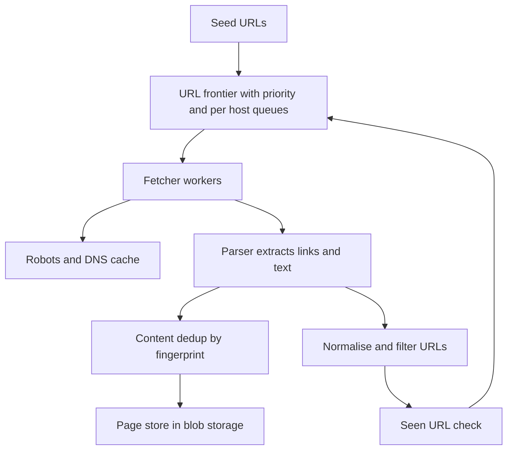

## The hook

A search engine is only as good as what it has seen. Somebody has to visit billions of pages, follow their links, notice when they change, and do it without knocking any website over.

A naive crawler is ten lines of code: take a URL, download it, extract links, add them to a queue, repeat. Run it on the real web and within an hour it has hammered one small site with 500 requests a second, downloaded the same page under 40 different URLs, and fallen into an online calendar that links to next month, forever.

Predict which of those three problems is the hardest to fix. (The calendar. The other two have clean data-structure answers.)

## Requirements

**Functional**
- Start from seed URLs, fetch pages, extract links, and keep crawling.
- Store page content for indexing.
- Re-crawl pages periodically, more often for pages that change often.

**Non-functional**
- Scale: about 1 billion pages per month (an estimate for a mid-sized crawl).
- **Politeness**: never overload a host; obey robots.txt.
- Robust to bad HTML, slow servers, traps and failures.
- Extensible: new content types and processing steps later.

:::analogy
An **army of librarians catalogues the world's books**. A head librarian keeps lists of shelves to visit, organised by building, so no building gets twenty librarians at once. Each librarian checks the building's rules at the door, copies the books, notes new references, and skips copies of books already catalogued. Some buildings have trick rooms that lead to endless identical corridors; experienced librarians know when to turn back.
:::

## Back-of-envelope numbers

All numbers are **estimates**.

- 1,000,000,000 pages per month ÷ (30 × 86,400 s) ≈ **386 pages per second** on average; plan for several times that at peak.
- Average page about 100 KB: 10⁹ × 100 KB = **100 TB per month**, about **6 PB over five years** if everything is kept.
- Seen-URL memory for 10 billion URLs: 8-byte hashes ≈ **80 GB**; a Bloom filter at 1% false positives ≈ **12 GB** (about 9.6 bits per URL).
- Politeness: at about 1 request per second per host, sustaining 386 pages per second needs at least **386 different hosts** being fetched at any moment, so the frontier must spread work across many hosts.

## High-level design

1. The **[[URL frontier]]** hands out URLs by priority and politeness.
2. **Fetcher workers** resolve DNS (cached), check **[[robots.txt]]** (cached per host), download with timeouts and size limits.
3. The **parser** extracts text and links.
4. **Content dedup** drops pages whose fingerprint was already stored.
5. Pages go to blob storage for the indexer.
6. Links are normalised, filtered and checked against the seen set; new ones enter the frontier.

## Deep dives

### 1. The frontier: priority and politeness

Two layers, as in many large crawlers:

- **Front queues by priority**: important or frequently changing pages (news homepages) ahead of rarely changing ones.
- **Back queues by host**: each host has its own queue and a "next allowed fetch time". A heap ordered by that time tells workers which host is ready next.

Wait, why not just put a delay in each worker? Because 100 workers sleeping politely on the same host are still 100 concurrent connections to it. **[[Politeness]]** must be enforced per host, centrally, which is exactly what per-host queues do.

The frontier is huge, so it lives mostly on disk or in a durable queue, with only each host's head in memory, partitioned across frontier servers by host (all URLs of one host on one server, so politeness needs no coordination).

### 2. Not crawling the same thing twice

Two different problems:

| Duplicate kind | Example | Fix |
|---|---|---|
| Same page, different URL | http vs https, trailing slash, tracking parameters, mixed-case hosts | **[[URL normalisation]]** before the seen check |
| Same content, different page | Mirrors, printer-friendly copies | **[[Content fingerprint]]**: hash of the page; near-duplicates with SimHash or MinHash |

The seen-URL set is checked for every extracted link, so it must be fast. A Bloom filter answers "definitely not seen" in memory, as in [The Data Structure That Is Allowed to Lie](article:famous-algos-bloom-filter). Its false positives mean a small fraction of new URLs are skipped, an acceptable loss for a crawler; a disk-backed exact set can back it up for important domains.

### 3. Crawler traps

A **[[crawler trap]]** produces endless unique URLs: calendars, session ids in links, infinitely nested paths, generated search pages. This is the hardest problem from the hook because no single data structure detects "endless" in advance. Defences:

- Limits on URL length, path depth and pages per host per crawl cycle.
- Detect repeating path segments (`/a/b/a/b/a/b/`).
- Strip known session and tracking parameters.
- Watch per-host yield: if a host produces thousands of pages with near-identical content, deprioritise it.

### 4. Re-crawling

Pages change at different rates. Track each page's change history: if its fingerprint changed on most visits, shorten its revisit interval; if it rarely changes, lengthen it. Use conditional requests (If-Modified-Since, ETags) to avoid downloading unchanged pages.

### 5. Robustness

- Timeouts and maximum page sizes; skip binary content you do not index.
- Retry transient errors with backoff; give up on persistent ones.
- Checkpoint the frontier, so a crashed frontier server restarts where it left off.
- DNS caching, since DNS lookups otherwise dominate latency.

:::insight
A crawler is a giant graph traversal with manners: a frontier that balances priority against per-host politeness, normalisation and hashing so nothing is fetched twice, and defensive limits so infinite sites cannot swallow it. Most of the difficulty is in being polite and not being fooled, not in downloading.
:::

## Trade-offs

| Decision | Choice | Trade-off |
|---|---|---|
| Traversal order | Priority-based (not pure BFS or DFS) | Better coverage of important pages; needs a scoring signal |
| Seen set | Bloom filter plus exact store for key domains | Small memory; about 1% of new URLs skipped |
| Frontier partitioning | By host | Politeness without coordination; uneven hosts make uneven partitions |
| Content storage | Keep latest version only, or history | Storage versus the ability to see changes |
| JavaScript rendering | Render only important pages with a headless browser | Much more expensive per page |

:::warning
Common misconception: "a crawler is just BFS over links." Pure BFS ignores importance and politeness: it fetches long runs of URLs from the same host back to back and spends equal effort on spam and on major news sites. Real crawlers order by priority and schedule by host.
:::

:::try-this
A worker extracts these links: `HTTP://Example.com:80/a/../b/?utm_source=x`, `http://example.com/b/`, `http://example.com/b`. How many distinct pages should enter the frontier after normalisation? (Typically one: lowercase the scheme and host, drop the default port 80, resolve `/a/../b/` to `/b/`, strip the tracking parameter, and apply a consistent trailing-slash rule. Whether `/b` and `/b/` are the same is site-specific, so many crawlers also rely on content fingerprints to catch the remaining duplicates.)
:::

## What can go wrong

- **Overloading a site** without per-host rate limits, which gets the crawler blocked and harms the site.
- **Ignoring robots.txt** or caching it forever without refreshing.
- **Traps** consuming the crawl budget.
- **Duplicate explosion** from weak normalisation.
- **Frontier loss** on a crash without checkpoints.
- **Spam and link farms** inflating priorities; score pages with signals beyond link counts.

### Interview follow-ups

**"How would you distribute the crawler across data centres?"** Partition hosts geographically so each data centre crawls nearby sites, with the frontier and seen sets partitioned by host.

**"How do you prioritise what to crawl?"** Combine signals: link-based importance (like PageRank), how often the page changed historically, freshness requirements (news), and site quality.

**"What happens with JavaScript-heavy sites?"** Fetch the HTML first; render with a headless browser only for pages where the content needs it, because rendering is far more expensive.

## Further reading

- Najork and Heydon, "High-Performance Web Crawling" (Compaq SRC report, 2001), describing the Mercator crawler's frontier design.
- The Robots Exclusion Protocol, standardised as RFC 9309 (2022).

## Key takeaways

- A crawler is a priority-ordered traversal of the web graph: fetch, parse, extract links, deduplicate, and feed new URLs back into the frontier.
- The URL frontier combines priority queues with per-host queues and next-allowed times, so the crawler is both smart and polite.
- Normalise URLs and fingerprint content to avoid fetching or storing the same page twice; a Bloom filter keeps billions of seen URLs in memory.
- Crawler traps need explicit defences: limits on depth, length and pages per host, and detection of repeating patterns.
- Obey robots.txt, cache DNS and robots rules, checkpoint the frontier, and re-crawl pages at rates matching how often they change.
